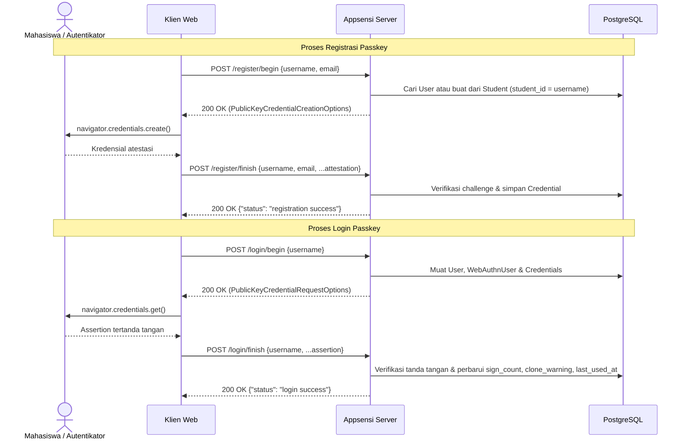
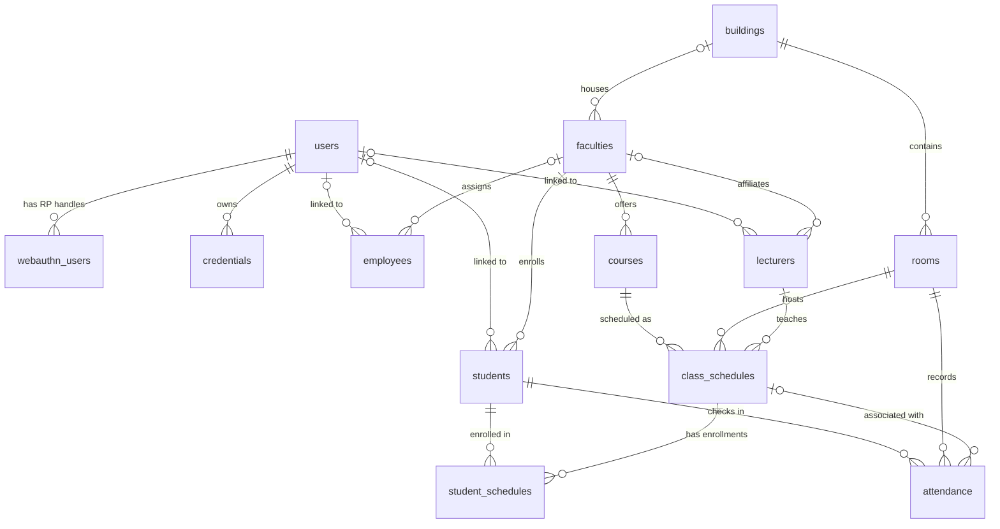

# Appsensi Server

[English](README.md) | **Bahasa Indonesia**

[](go.mod)
[](https://github.com/gin-gonic/gin)
[](https://gorm.io/)
[](https://github.com/go-webauthn/webauthn)
[](LICENSE)

Server REST API backend untuk **Appsensi**, platform presensi akademik kampus yang dibangun menggunakan Go, Gin, PostgreSQL (GORM), serta autentikasi tanpa kata sandi (*passwordless*) berbasis **WebAuthn / Passkey**.

---

## Fitur Utama

- **Autentikasi Passkey Tanpa Kata Sandi**: Mendukung alur registrasi dan login WebAuthn secara penuh menggunakan `go-webauthn`, dilengkapi *resident key*, petunjuk autentikator *cross-platform*/*hybrid*, pencegahan duplikasi kredensial perangkat, pelacakan `sign_count`, dan deteksi kloning kredensial (`clone_warning`).
- **Registrasi Terintegrasi Mahasiswa, Pegawai & Dosen**: Secara otomatis membuat akun pengguna (`users.user_type`: `student`, `employee`, atau `lecturer`) berdasarkan data `students`, `employees`, atau `lecturers` terverifikasi saat pendaftaran passkey pertama kali.
- **Dashboard Kampus Berbasis Peran**: Menyediakan endpoint `/dashboard/*` khusus dengan kontrol akses berbasis peran untuk **Keuangan** (`finance`), **Bagian Akademik** (`academic_affairs`), **Kemahasiswaan** (`student_affairs`, dibatasi per `faculty_id`), dan **Dosen** (`lecturer`).
- **Validasi Origin Terpadu (CORS & WebAuthn)**: Konfigurasi `ALLOWED_ORIGINS` digunakan bersama oleh middleware CORS Gin (mendukung kredensial & *preflight* `OPTIONS`) serta daftar `RPOrigins` pada WebAuthn.
- **Model Data Akademik, Staf & Presensi**: Skema PostgreSQL berbasis GORM yang mencakup gedung, ruangan, fakultas, mata kuliah, dosen, pegawai, jadwal kelas, pengambilan jadwal mahasiswa (*KRS*), hingga pencatatan kehadiran.

## Tumpukan Teknologi (*Tech Stack*)

| Komponen | Teknologi | Versi |
| :--- | :--- | :--- |
| Bahasa Pemrograman | [Go](https://go.dev/) | `1.27.0` |
| Framework HTTP | [Gin](https://github.com/gin-gonic/gin) | `v1.12.0` |
| Autentikasi | [go-webauthn/webauthn](https://github.com/go-webauthn/webauthn) | `v0.18.2` |
| ORM & Driver Database | [GORM](https://gorm.io/) + `gorm.io/driver/postgres` | `v1.31.2` / `v1.6.3` |
| Generator UUID | [google/uuid](https://github.com/google/uuid) | `v1.6.0` |

## Struktur Proyek

```text
appsensi-server/
├── config/
│   ├── cors.go              # Parser ALLOWED_ORIGINS & middleware CORS Gin
│   ├── cors_test.go         # Unit test untuk preflight CORS & parsing origin
│   ├── mds.go               # Penyedia metadata FIDO Conformance statis + MDS3 dinamis
│   ├── mds_test.go          # Unit test pemuatan MDS lokal & verifikasi MDS3
│   └── webauthn.go          # Inisialisasi Relying Party go-webauthn
├── controllers/
│   ├── attendance.go                     # Handler katalog ruangan, daftar hadir aktif & pencatatan presensi
│   ├── attendance_test.go                # Unit test alur katalog, roster & check-in presensi
│   ├── auth.go                           # Handler registrasi/login WebAuthn & penyimpanan sesi di memori
│   ├── auth_test.go                      # Unit test alur registrasi/login WebAuthn produksi & isolasi sesi
│   ├── conformance.go                    # Endpoint standar FIDO2 Conformance Server
│   ├── conformance_test.go               # Unit test validasi & alur FIDO2 Conformance
│   ├── dashboard_academic.go             # Handler ringkasan & CRUD dashboard Bagian Akademik
│   ├── dashboard_academic_test.go        # Unit test handler dashboard Bagian Akademik
│   ├── dashboard_auth.go                 # Penyimpanan sesi passkey, resolusi identitas & helper RBAC
│   ├── dashboard_finance.go              # Handler ringkasan & direktori SKS mahasiswa dashboard Keuangan
│   ├── dashboard_finance_test.go         # Unit test handler dashboard Keuangan
│   ├── dashboard_lecturer.go             # Handler jadwal, daftar mahasiswa & presensi sesi dashboard Dosen
│   ├── dashboard_lecturer_test.go        # Unit test handler dashboard Dosen
│   ├── dashboard_student_affairs.go      # Handler CRUD mahasiswa, KRS & laporan presensi Kemahasiswaan
│   ├── dashboard_student_affairs_test.go # Unit test handler dashboard Kemahasiswaan
│   ├── registration.go                   # Handler registrasi mahasiswa/pegawai/dosen, penautan user & pembersihan akun
│   ├── registration_test.go              # Unit test alur direktori registrasi, penautan & pembersihan akun
│   ├── sql_optimization_test.go          # Unit test verifikasi optimasi query SQL & indeks
│   └── types.go                          # Tipe respons error/status API bersama & value type RoomCode/SessionDate
├── database/
│   ├── db.go                # Konfigurasi koneksi PostgreSQL dengan GORM
│   ├── migrate.go           # Auto-migrasi skema & indeks opt-in dengan pelacakan fingerprint SHA-256
│   ├── migrate_test.go      # Unit test helper fingerprint skema & migrasi
│   └── optimize_indexes.sql # Indeks komposit & parsial PostgreSQL untuk jalur query utama
├── models/
│   ├── academic.go      # Model Building, Room, Faculty, Course, ClassSchedule
│   ├── schema_test.go   # Unit test kesesuaian nama kolom GORM dengan tag JSON
│   ├── staff.go         # Model Employee (finance, academic_affairs, student_affairs) & Lecturer
│   ├── student.go       # Model Student, StudentSchedule, Attendance
│   └── user.go          # Model User, WebAuthnUser, Credential (implementasi webauthn.User)
├── LICENSE              # Lisensi MIT
├── README.id.md         # Dokumentasi Bahasa Indonesia
├── README.md            # Dokumentasi Bahasa Inggris (default)
├── go.mod
├── go.sum
└── main.go              # Titik masuk aplikasi & definisi rute HTTP
```

---

## Memulai (*Getting Started*)

### Prasyarat

- **Go** `1.27` atau lebih baru
- **PostgreSQL** `13` atau lebih baru (menggunakan fungsi bawaan `gen_random_uuid()` untuk *primary key* bertipe UUID)
- Peramban (*browser*) yang mendukung WebAuthn dan diakses melalui `http://localhost` (atau HTTPS pada lingkungan produksi)

### Variabel Lingkungan (*Environment Variables*)

| Variabel | Nilai Bawaan (*Default*) | Deskripsi |
| :--- | :--- | :--- |
| `PORT` | `8080` | Port tempat server HTTP berjalan. |
| `DATABASE_URL` | *(fallback dev lokal di `database/db.go`)* | String koneksi / DSN PostgreSQL (contoh: `host=localhost user=postgres password=<password> dbname=appsensi port=5432 sslmode=disable TimeZone=Asia/Jakarta` atau `postgres://...`). |
| `ALLOWED_ORIGINS` | `http://localhost:3000` | Daftar origin frontend yang dipisahkan koma untuk izin CORS sekaligus `RPOrigins` WebAuthn (spasi berlebih dan garis miring di akhir karakter otomatis dibersihkan). |
| `DB_AUTO_MIGRATE` | `false` | Setel ke `true` untuk menjalankan `AutoMigrate` GORM dan pembuatan indeks secara otomatis hanya ketika skema model atau definisi indeks berubah (dilacak menggunakan *fingerprint* SHA-256 pada tabel `app_schema_meta`). |
| `DB_MAX_OPEN_CONNS` | `20` | Jumlah maksimum koneksi terbuka ke PostgreSQL pada *pool* `sql.DB`. |
| `DB_MAX_IDLE_CONNS` | `10` | Jumlah maksimum koneksi *idle* yang dipertahankan pada *pool* `sql.DB` (dibatasi hingga `DB_MAX_OPEN_CONNS`). |
| `DB_SIMPLE_PROTOCOL` | `false` | Setel ke `true` jika terhubung melalui *connection pooler* mode transaksi (mis. PgBouncer / Supavisor) untuk menonaktifkan *cache* *prepared statement* protokol diperluas `pgx`. |

> [!IMPORTANT]
> **Catatan Pengembangan Lokal**
> 1. **Migrasi Skema Database**: Migrasi skema otomatis bersifat *opt-in* (`DB_AUTO_MIGRATE=false` secara bawaan). Setel `DB_AUTO_MIGRATE=true` agar migrasi skema dan indeks dijalankan otomatis saat perubahan terdeteksi, atau terapkan skema SQL serta `database/optimize_indexes.sql` secara manual.
> 2. **Prasyarat Data Direktori (`students` / `employees` / `lecturers`)**: Saat mendaftarkan `username` baru pertama kali, endpoint `POST /register/begin` mencari baris pada tabel `students` (`student_id = username`), `employees` (`employee_id = username`), atau `lecturers` (`lecturer_id = username`) untuk membuat akun di tabel `users` (`user_type`: `student`, `employee`, atau `lecturer`) dan mengisi `display_name`. Pastikan data tersebut sudah ada sebelum melakukan registrasi.
> 3. **Konfigurasi `RPID` WebAuthn & Penyimpanan Sesi**: `RPID` saat ini disetel ke `"localhost"` di `config/webauthn.go`. Akses aplikasi frontend lokal menggunakan `http://localhost:<port>` (bukan `127.0.0.1`) agar validasi domain WebAuthn di peramban berhasil. Sesi tantangan (*challenge*) registrasi/login disimpan di peta memori (*in-memory map*) pada `controllers/auth.go`.

### Instalasi & Menjalankan Server

1. **Kloning repositori dan unduh dependensi**:
   ```bash
   git clone https://github.com/hapnan/appsensi-server.git
   cd appsensi-server
   go mod download
   ```

2. **Atur variabel lingkungan lalu jalankan server**:

   **PowerShell (Windows)**
   ```powershell
   $env:PORT = "8080"
   $env:DATABASE_URL = "host=localhost user=postgres password=<password> dbname=appsensi port=5432 sslmode=disable TimeZone=Asia/Jakarta"
   $env:ALLOWED_ORIGINS = "http://localhost:3000"
   go run main.go
   ```

   **Bash (Linux / macOS)**
   ```bash
   export PORT="8080"
   export DATABASE_URL="host=localhost user=postgres password=<password> dbname=appsensi port=5432 sslmode=disable TimeZone=Asia/Jakarta"
   export ALLOWED_ORIGINS="http://localhost:3000"
   go run main.go
   ```

3. **Pastikan server sudah aktif**:
   ```bash
   curl http://localhost:8080/ping
   # {"message":"pong"}
   ```

---

## Alur Autentikasi & Referensi API

### Diagram Urutan Registrasi & Login Passkey



### Ringkasan Endpoint

| Metode | Path | Deskripsi |
| :--- | :--- | :--- |
| `GET` | `/ping` | Pemeriksaan status server (*health check*), mengembalikan `{"message": "pong"}`. |
| `POST` | `/register/begin` | Menghasilkan opsi pembuatan kredensial WebAuthn untuk mahasiswa, pegawai, atau dosen. |
| `POST` | `/register/finish` | Memverifikasi respons atestasi, menyimpan kredensial passkey, dan menautkan akun. |
| `POST` | `/login/begin` | Menghasilkan opsi tantangan (*assertion*) login WebAuthn bagi pengguna terdaftar. |
| `POST` | `/login/finish` | Memverifikasi tanda tangan *assertion*, memperbarui metadata kredensial, dan menerbitkan token sesi. |
| `GET` | `/attendance/demo-catalog` | Menampilkan daftar ruang kelas terjadwal beserta sesi kelas mingguannya. |
| `GET` | `/attendance/roster` | Mengembalikan sesi kelas aktif dan daftar mahasiswa yang belum *check-in*. |
| `POST` | `/attendance/check-in` | Mencatat kehadiran mahasiswa yang telah terverifikasi pada sesi kelas aktif. |
| `GET` | `/registration/list` | Menampilkan seluruh mahasiswa beserta status akun WebAuthn & passkey. |
| `POST` | `/registration/link-student` | Menautkan `students.user_id` ke `users.id` (idempoten). |
| `GET` | `/registration/employees` | Menampilkan seluruh pegawai beserta peran (`jobRole`), fakultas, dan status passkey. |
| `POST` | `/registration/link-employee` | Menautkan `employees.user_id` ke `users.id` (idempoten). |
| `GET` | `/registration/lecturers` | Menampilkan seluruh dosen beserta fakultas dan status passkey. |
| `POST` | `/registration/link-lecturer` | Menautkan `lecturers.user_id` ke `users.id` (idempoten). |
| `POST` | `/registration/cleanup-incomplete` | Menghapus baris `users` belum terverifikasi (tanpa kredensial passkey). |
| `GET` | `/dashboard/me` | Mengembalikan profil pengguna terautentikasi beserta `userType`, `jobRole`, dan `facultyId`. |
| `GET` | `/dashboard/finance/summary` | Ringkasan jumlah mahasiswa & total SKS tingkat kampus dan per fakultas (peran `finance`). |
| `GET` | `/dashboard/finance/students` | Menampilkan daftar mahasiswa beserta jumlah mata kuliah & SKS diambil (peran `finance`). |
| `GET` | `/dashboard/academic/summary` | Ringkasan jumlah fakultas, gedung, ruangan, mata kuliah, staf, jadwal & mahasiswa (peran `academic_affairs`). |
| `GET` | `/dashboard/academic/faculties` | Menampilkan daftar fakultas (peran `academic_affairs`). |
| `POST` | `/dashboard/academic/faculties` | Menambahkan fakultas baru (peran `academic_affairs`). |
| `PUT` | `/dashboard/academic/faculties/:id` | Memperbarui data fakultas (peran `academic_affairs`). |
| `GET` | `/dashboard/academic/courses` | Menampilkan daftar mata kuliah dengan filter opsional `facultyId` (peran `academic_affairs`). |
| `POST` | `/dashboard/academic/courses` | Menambahkan mata kuliah baru (peran `academic_affairs`). |
| `PUT` | `/dashboard/academic/courses/:id` | Memperbarui data mata kuliah (peran `academic_affairs`). |
| `DELETE` | `/dashboard/academic/courses/:id` | Menghapus mata kuliah (peran `academic_affairs`). |
| `GET` | `/dashboard/academic/lecturers` | Menampilkan daftar dosen dengan filter opsional `facultyId` (peran `academic_affairs`). |
| `POST` | `/dashboard/academic/lecturers` | Menambahkan dosen baru (peran `academic_affairs`). |
| `PUT` | `/dashboard/academic/lecturers/:id` | Memperbarui data dosen (peran `academic_affairs`). |
| `DELETE` | `/dashboard/academic/lecturers/:id` | Menghapus dosen (peran `academic_affairs`). |
| `GET` | `/dashboard/academic/employees` | Menampilkan daftar pegawai dengan filter opsional `jobRole` & `facultyId` (peran `academic_affairs`). |
| `POST` | `/dashboard/academic/employees` | Menambahkan pegawai baru (peran `academic_affairs`). |
| `PUT` | `/dashboard/academic/employees/:id` | Memperbarui data pegawai (peran `academic_affairs`). |
| `DELETE` | `/dashboard/academic/employees/:id` | Menghapus pegawai (peran `academic_affairs`). |
| `GET` | `/dashboard/academic/schedules` | Menampilkan daftar jadwal kelas dengan filter `courseId`, `lecturerId`, `academicTerm` (peran `academic_affairs`). |
| `POST` | `/dashboard/academic/schedules` | Menambahkan jadwal kelas baru (peran `academic_affairs`). |
| `PUT` | `/dashboard/academic/schedules/:id` | Memperbarui jadwal kelas (peran `academic_affairs`). |
| `DELETE` | `/dashboard/academic/schedules/:id` | Menghapus jadwal kelas (peran `academic_affairs`). |
| `GET` | `/dashboard/student-affairs/summary` | Ringkasan jumlah mahasiswa, mata kuliah, KRS & presensi fakultas (peran `student_affairs`). |
| `GET` | `/dashboard/student-affairs/students` | Menampilkan daftar mahasiswa pada fakultas pegawai (peran `student_affairs`). |
| `POST` | `/dashboard/student-affairs/students` | Menambahkan mahasiswa baru pada fakultas pegawai (peran `student_affairs`). |
| `PUT` | `/dashboard/student-affairs/students/:id` | Memperbarui data mahasiswa pada fakultas pegawai (peran `student_affairs`). |
| `DELETE` | `/dashboard/student-affairs/students/:id` | Menghapus mahasiswa pada fakultas pegawai (peran `student_affairs`). |
| `GET` | `/dashboard/student-affairs/students/:id/schedules` | Menampilkan jadwal kelas (KRS) yang diambil mahasiswa fakultas (peran `student_affairs`). |
| `POST` | `/dashboard/student-affairs/students/:id/schedules` | Mendaftarkan mahasiswa fakultas ke jadwal kelas (peran `student_affairs`). |
| `DELETE` | `/dashboard/student-affairs/students/:id/schedules/:scheduleId` | Membatalkan jadwal kelas mahasiswa fakultas (peran `student_affairs`). |
| `GET` | `/dashboard/student-affairs/attendance` | Menampilkan catatan presensi mahasiswa pada fakultas pegawai (peran `student_affairs`). |
| `GET` | `/dashboard/lecturer/summary` | Ringkasan jadwal kelas, mahasiswa terdaftar & total presensi dosen (akun `lecturer`). |
| `GET` | `/dashboard/lecturer/schedules` | Menampilkan daftar jadwal kelas yang diampu dosen (akun `lecturer`). |
| `GET` | `/dashboard/lecturer/schedules/:scheduleId/students` | Menampilkan daftar mahasiswa peserta jadwal kelas dosen (akun `lecturer`). |
| `GET` | `/dashboard/lecturer/schedules/:scheduleId/attendance` | Mengembalikan lembar presensi sesi untuk jadwal kelas dan tanggal tertentu (akun `lecturer`). |
| `POST` | `/dashboard/lecturer/schedules/:scheduleId/attendance` | Mencatat kehadiran mahasiswa secara manual pada jadwal kelas dosen (akun `lecturer`). |
| `DELETE` | `/dashboard/lecturer/schedules/:scheduleId/attendance/:studentId` | Menghapus catatan kehadiran mahasiswa pada tanggal sesi tertentu (akun `lecturer`). |

### Detail Endpoint

#### `GET /ping`
Memeriksa apakah server berjalan normal.
- **Respons (`200 OK`)**:
  ```json
  {
    "message": "pong"
  }
  ```

#### `POST /register/begin`
Memulai sesi registrasi WebAuthn. Membuat baris `users` (ditautkan berdasarkan `username` ke `students.student_id`) serta handle `webauthn_users` apabila belum tersedia, sekaligus mengecualikan kredensial perangkat yang sudah pernah didaftarkan pengguna tersebut.
- **Body Permintaan**:
  ```json
  {
    "username": "20260001",
    "email": "mahasiswa@example.edu"
  }
  ```
- **Respons (`200 OK`)**: JSON standar `CredentialCreation` WebAuthn (`{ "publicKey": { ... } }`).

#### `POST /register/finish`
Menyelesaikan proses registrasi passkey. Mengharapkan satu objek JSON yang memuat **`username` dan `email` di level teratas (*top-level*)** digabung langsung dengan respons atestasi `PublicKeyCredential` dari peramban, serta menautkan `students.user_id` ke `users.id` secara otomatis apabila belum tertaut.
- **Body Permintaan**:
  ```json
  {
    "username": "20260001",
    "email": "mahasiswa@example.edu",
    "id": "<base64url-credential-id>",
    "rawId": "<base64url-credential-id>",
    "type": "public-key",
    "response": {
      "attestationObject": "<base64url>",
      "clientDataJSON": "<base64url>"
    }
  }
  ```
- **Respons (`200 OK`)**:
  ```json
  {
    "status": "registration success"
  }
  ```

#### `POST /login/begin`
Memulai proses login WebAuthn untuk pengguna yang sudah terdaftar tanpa membuat baris baru di database.
- **Body Permintaan**:
  ```json
  {
    "username": "20260001"
  }
  ```
- **Respons (`200 OK`)**: JSON standar `CredentialAssertion` WebAuthn (`{ "publicKey": { ... } }`).
- **Error (`404 Not Found`)**: Dikembalikan jika pengguna belum terdaftar atau belum memiliki handle WebAuthn untuk `RPID` aktif.

#### `POST /login/finish`
Menyelesaikan autentikasi passkey. Mengharapkan **`username` di level teratas** digabung dengan respons *assertion* `PublicKeyCredential` dari peramban. Memperbarui kolom `sign_count`, `clone_warning`, dan `last_used_at` pada kredensial terkait.
- **Body Permintaan**:
  ```json
  {
    "username": "20260001",
    "id": "<base64url-credential-id>",
    "rawId": "<base64url-credential-id>",
    "type": "public-key",
    "response": {
      "authenticatorData": "<base64url>",
      "clientDataJSON": "<base64url>",
      "signature": "<base64url>",
      "userHandle": "<base64url>"
    }
  }
  ```
- **Respons (`200 OK`)**:
  ```json
  {
    "status": "login success",
    "message": "User authenticated successfully"
  }
  ```

#### `GET /attendance/demo-catalog`
Menampilkan seluruh ruang kelas kampus yang memiliki jadwal mata kuliah beserta sesi kelas mingguannya, diurutkan berdasarkan gedung, lantai, dan nomor ruangan.
- **Respons (`200 OK`)**: `DemoCatalogRoom[]` (`code`, `floor`, `roomNumber`, `buildingCode`, `buildingName`, `facultyCode`, `facultyName`, `schedules`).

#### `GET /attendance/roster`
Mengembalikan sesi jadwal kelas aktif beserta daftar mahasiswa terdaftar yang belum melakukan *check-in* pada tanggal terkait.
- **Parameter Query**:
  - `room` *(wajib)*: Kode ruangan dengan format `building.floor.room` (contoh: `h.2.4`, tidak peka huruf besar/kecil).
  - `scheduleId` *(opsional)*: UUID `class_schedules.id` eksplisit untuk memilih sesi tertentu pada hari tersebut.
  - `date` *(opsional)*: Tanggal kalender berformat `YYYY-MM-DD` (bawaan: hari ini menurut waktu server).
- **Respons (`200 OK`)**: `RosterResult` (`room`, `sessionDate`, `dayOfWeek`, `schedule`, `availableSchedules`, `total`, `present`, `pending`).
- **Error (`400 Bad Request`)**: Dikembalikan jika format `room`, `scheduleId`, atau `date` tidak valid.

#### `POST /attendance/check-in`
Mencatat kehadiran mahasiswa ke tabel `attendance` untuk sesi kelas aktif pada suatu ruangan.
- **Body Permintaan**:
  ```json
  {
    "room": "h.2.4",
    "studentId": "STU-FCS-001",
    "scheduleId": "<uuid-opsional>",
    "date": "2026-11-04"
  }
  ```
- **Respons (`200 OK`)**:
  ```json
  {
    "id": "<student-uuid>",
    "studentId": "STU-FCS-001",
    "name": "Nama Mahasiswa",
    "room": "h.2.4",
    "sessionDate": "2026-11-04",
    "checkedInAt": "2026-11-04T09:15:00Z"
  }
  ```
- **Error**: `400 Bad Request` (input tidak valid atau mahasiswa tidak mengambil kelas tersebut), `404 Not Found` (ruangan atau mahasiswa tidak ditemukan), `412 Precondition Failed` (belum mendaftarkan passkey atau tidak ada sesi kelas terjadwal), `409 Conflict` (sudah tercatat hadir).

#### `GET /registration/list`
Menampilkan seluruh mahasiswa diurutkan berdasarkan `student_id` beserta informasi akun `users` dan status registrasi passkey (`isRegistered`).
- **Respons (`200 OK`)**: `RegistrationStudentRow[]` (`id`, `name`, `username`, `department`, `userId`, `email`, `createdAt`, `isRegistered`).

#### `POST /registration/link-student`
Menautkan `students.user_id` ke `users.id` secara idempoten untuk `username` yang telah terdaftar.
- **Body Permintaan**: `{ "studentId": "<student-uuid>", "username": "STU-FCS-001" }`
- **Respons (`200 OK`)**: `{ "userId": "<user-uuid>", "email": "mahasiswa@example.edu", "createdAt": "..." }`
- **Error**: `400 Bad Request`, `404 Not Found`.

#### `GET /registration/employees`
Menampilkan seluruh pegawai diurutkan berdasarkan `employee_id` beserta `jobRole` (`finance`, `academic_affairs`, `student_affairs`), informasi fakultas, akun `users`, dan status registrasi passkey (`isRegistered`).
- **Respons (`200 OK`)**: `RegistrationEmployeeRow[]` (`id`, `name`, `username`, `department`, `jobRole`, `facultyId`, `facultyCode`, `facultyName`, `userId`, `email`, `createdAt`, `isRegistered`).

#### `POST /registration/link-employee`
Menautkan `employees.user_id` ke `users.id` secara idempoten untuk `username` pegawai yang telah terdaftar.
- **Body Permintaan**: `{ "employeeId": "<employee-uuid>", "username": "EMP-FIN-001" }`
- **Respons (`200 OK`)**: `{ "userId": "<user-uuid>", "email": "staf@example.edu", "createdAt": "..." }`
- **Error**: `400 Bad Request`, `404 Not Found`.

#### `GET /registration/lecturers`
Menampilkan seluruh dosen diurutkan berdasarkan `lecturer_id` beserta informasi fakultas, akun `users`, dan status registrasi passkey (`isRegistered`).
- **Respons (`200 OK`)**: `RegistrationLecturerRow[]` (`id`, `name`, `username`, `department`, `facultyId`, `facultyCode`, `facultyName`, `userId`, `email`, `createdAt`, `isRegistered`).

#### `POST /registration/link-lecturer`
Menautkan `lecturers.user_id` ke `users.id` secara idempoten untuk `username` dosen yang telah terdaftar.
- **Body Permintaan**: `{ "lecturerId": "<lecturer-uuid>", "username": "LEC-FCS-001" }`
- **Respons (`200 OK`)**: `{ "userId": "<user-uuid>", "email": "dosen@example.edu", "createdAt": "..." }`
- **Error**: `400 Bad Request`, `404 Not Found`.

#### `POST /registration/cleanup-incomplete`
Menghapus baris `users` yang belum terverifikasi (memiliki 0 kredensial passkey) dan membersihkan sesi tantangan WebAuthn yang menggantung jika proses registrasi dibatalkan.
- **Body Permintaan**: `{ "username": "STU-FCS-001" }`
- **Respons (`200 OK`)**: `{ "cleaned": true }` (atau `{ "cleaned": false }` jika tidak ditemukan atau sudah memiliki kredensial).

#### Autentikasi Dashboard & Endpoint Berbasis Peran (`/dashboard/*`)
Seluruh endpoint `/dashboard/*` mengautentikasi pengguna melalui header `Authorization: Bearer <sessionToken>` atau `X-Session-Token` (yang diterbitkan saat `POST /login/finish`), maupun melalui header `X-User-ID` / `X-Username` (atau parameter query `userId` / `username`).

- **`GET /dashboard/me`**: Mengembalikan `DashboardUserContext` (`userId`, `username`, `email`, `displayName`, `userType`, `profileId`, `jobRole`, `department`, `facultyId`, `facultyCode`, `facultyName`).
- **Dashboard Keuangan (`/dashboard/finance/*` — memerlukan `employee` dengan `job_role = "finance"`)**:
  - `GET /dashboard/finance/summary` (opsional `?academicTerm=`): Mengembalikan ringkasan `totalStudents`, `registeredStudents`, `enrolledStudents`, `totalCredits`, `totalFaculties`, dan rincian `byFaculty`.
  - `GET /dashboard/finance/students` (opsional `?facultyId=`, `?academicTerm=`, `?search=`): Menampilkan daftar mahasiswa beserta `enrolledCourses`, `enrolledCredits`, dan `isRegistered`.
- **Dashboard Bagian Akademik (`/dashboard/academic/*` — memerlukan `employee` dengan `job_role = "academic_affairs"`)**:
  - `GET /dashboard/academic/summary`: Mengembalikan ringkasan jumlah infrastruktur akademik dan staf kampus.
  - `GET|POST /dashboard/academic/faculties` & `PUT /dashboard/academic/faculties/:id`: Pengelolaan data fakultas.
  - `GET|POST /dashboard/academic/courses` & `PUT|DELETE /dashboard/academic/courses/:id`: Pengelolaan mata kuliah (dapat difilter dengan `?facultyId=`).
  - `GET|POST /dashboard/academic/lecturers` & `PUT|DELETE /dashboard/academic/lecturers/:id`: Pengelolaan dosen (dapat difilter dengan `?facultyId=`).
  - `GET|POST /dashboard/academic/employees` & `PUT|DELETE /dashboard/academic/employees/:id`: Pengelolaan pegawai (dapat difilter dengan `?jobRole=` & `?facultyId=`; mewajibkan `faculty_id` apabila `jobRole = "student_affairs"`).
  - `GET|POST /dashboard/academic/schedules` & `PUT|DELETE /dashboard/academic/schedules/:id`: Pengelolaan jadwal kelas (dapat difilter dengan `?courseId=`, `?lecturerId=`, `?academicTerm=`).
- **Dashboard Kemahasiswaan (`/dashboard/student-affairs/*` — memerlukan `employee` dengan `job_role = "student_affairs"` dan `faculty_id` terisi)**:
  - `GET /dashboard/student-affairs/summary`: Mengembalikan jumlah mahasiswa, mata kuliah, pengambilan KRS, dan presensi pada fakultas pegawai.
  - `GET|POST /dashboard/student-affairs/students` & `PUT|DELETE /dashboard/student-affairs/students/:id`: CRUD mahasiswa lingkup fakultas (mendukung `?search=` & `?department=`).
  - `GET|POST /dashboard/student-affairs/students/:id/schedules` & `DELETE /dashboard/student-affairs/students/:id/schedules/:scheduleId`: Pengelolaan pengambilan jadwal kelas (KRS) mahasiswa pada fakultas terkait.
  - `GET /dashboard/student-affairs/attendance`: Menampilkan laporan presensi mahasiswa pada fakultas terkait (opsional `?scheduleId=`, `?studentId=`, `?date=YYYY-MM-DD`).
- **Dashboard Dosen (`/dashboard/lecturer/*` — memerlukan akun `lecturer`)**:
  - `GET /dashboard/lecturer/summary`: Mengembalikan total jadwal kelas yang diampu, mahasiswa terdaftar, dan catatan presensi.
  - `GET /dashboard/lecturer/schedules`: Menampilkan daftar jadwal kelas yang diampu dosen (opsional `?academicTerm=`, `?dayOfWeek=`).
  - `GET /dashboard/lecturer/schedules/:scheduleId/students`: Menampilkan daftar mahasiswa beserta jumlah kehadiran pada jadwal kelas tersebut.
  - `GET /dashboard/lecturer/schedules/:scheduleId/attendance`: Mengembalikan lembar presensi sesi (`present` / `absent` per mahasiswa) untuk `?date=YYYY-MM-DD`.
  - `POST /dashboard/lecturer/schedules/:scheduleId/attendance`: Mencatat kehadiran mahasiswa secara manual (`{ "studentId": "...", "date": "YYYY-MM-DD" }`).
  - `DELETE /dashboard/lecturer/schedules/:scheduleId/attendance/:studentId?date=YYYY-MM-DD`: Menghapus catatan kehadiran mahasiswa pada tanggal sesi tersebut.

### Perilaku Middleware CORS

- Origin yang terdaftar di `ALLOWED_ORIGINS` akan menerima header `Access-Control-Allow-Origin: <origin>` serta `Access-Control-Allow-Credentials: true`.
- Permintaan *preflight* `OPTIONS` dari origin yang diizinkan (atau tanpa header `Origin`) dibalas dengan status `204 No Content`.
- Permintaan *preflight* `OPTIONS` dari origin yang tidak diizinkan ditolak dengan status `403 Forbidden`.

---

## Skema Database

### Diagram Relasi Entitas (*ER Diagram*)



### Ringkasan Tabel

#### Autentikasi & Passkey (`models/user.go`)

| Tabel | Model | Kegunaan |
| :--- | :--- | :--- |
| `users` | `User` | Tabel akun utama (`id`, `email`, `username`, `display_name`, `user_type` [`student`, `employee`, `lecturer`]), mengimplementasikan antarmuka `webauthn.User`. |
| `webauthn_users` | `WebAuthnUser` | Menyimpan `handle` biner 32-byte WebAuthn pengguna yang unik untuk setiap pasangan `(rp_id, user_id)`. |
| `credentials` | `Credential` | Menyimpan kunci publik passkey, `aaguid`, metadata atestasi, `transport`, `flags`, `sign_count`, `clone_warning`, dan `last_used_at`. |

#### Akademik, Staf & Presensi (`models/academic.go`, `models/staff.go`, `models/student.go`)

| Tabel | Model | Kegunaan |
| :--- | :--- | :--- |
| `buildings` | `Building` | Data gedung kampus (`code`, `name`, `purpose`, `has_classes`, `total_floors`). |
| `rooms` | `Room` | Ruang kelas dan fasilitas yang terhubung ke `building_id` (`code`, `floor`, `room_number`, `capacity`). |
| `faculties` | `Faculty` | Data fakultas (`code`, `name`), dengan relasi opsional ke `building_id`. |
| `courses` | `Course` | Mata kuliah yang diselenggarakan fakultas (`code`, `name`, `credits`, `description`, `faculty_id`). |
| `employees` | `Employee` | Direktori pegawai kampus (`employee_id`, `name`, `department`, `job_role` [`finance`, `academic_affairs`, `student_affairs`], `faculty_id`, `photo_url`, serta `user_id` opsional). |
| `lecturers` | `Lecturer` | Direktori dosen (`lecturer_id`, `name`, `department`, `faculty_id`, `photo_url`, serta `user_id` opsional). |
| `class_schedules` | `ClassSchedule` | Jadwal kelas per sesi/seksi (`course_id`, `room_id`, `lecturer_id`, `section`, `instructor`, `day_of_week`, `start_time`, `end_time`, `academic_term`). |
| `students` | `Student` | Data induk mahasiswa (`student_id`, `name`, `department`, `faculty_id`, `photo_url`, serta `user_id` opsional). |
| `student_schedules` | `StudentSchedule` | Tabel relasi pengambilan jadwal kelas oleh mahasiswa (`status`, `enrolled_at`). |
| `attendance` | `Attendance` | Catatan kehadiran harian mahasiswa per ruangan/sesi (`student_id`, `room_id`, `class_schedule_id`, `session_date`, `checked_in_at`). |

---

## Pengujian (*Testing*)

Jalankan seluruh *unit test* tanpa memerlukan koneksi database PostgreSQL aktif:

```bash
go test -v ./...
```

Cakupan pengujian saat ini meliputi:
- **`config/cors_test.go`**: Pengujian parsing `ALLOWED_ORIGINS` (normalisasi spasi dan garis miring penutup) serta perilaku middleware CORS untuk origin yang diizinkan, header kredensial, dan penolakan *preflight* dari origin asing.
- **`config/mds_test.go`**: Pemuatan metadata lokal FIDO Conformance (`fido-conformance-mds/`), dukungan algoritma COSE (`ES256K` / `RS1`), serta verifikasi blob JWT MDS3 dinamis.
- **`controllers/attendance_test.go`**: Pengelompokan & pengurutan katalog ruangan demo, pemilihan sesi kelas aktif & perhitungan daftar hadir (*roster*), serta validasi & penanganan konflik *check-in* presensi.
- **`controllers/auth_test.go`**: Pengujian seremoni registrasi & login passkey WebAuthn produksi, isolasi sesi antar-seremoni, keamanan pembacaan ulang body request, dan keseragaman format `APIErrorResponse`.
- **`controllers/conformance_test.go`**: Pengujian menyeluruh registrasi & *assertion* FIDO2 Conformance (`/attestation/*`, `/assertion/*`).
- **`controllers/registration_test.go`**: Pengujian daftar direktori registrasi mahasiswa, pegawai, dan dosen, penautan idempoten `user_id`, serta pembersihan akun/sesi yang belum selesai.
- **`controllers/dashboard_finance_test.go`**: Otorisasi peran Keuangan (`finance`), agregasi ringkasan SKS tingkat kampus & per fakultas, serta pemfilteran direktori SKS mahasiswa.
- **`controllers/dashboard_academic_test.go`**: Otorisasi peran Bagian Akademik (`academic_affairs`), metrik ringkasan, serta operasi CRUD untuk fakultas, mata kuliah, dosen, pegawai (termasuk validasi cakupan fakultas `student_affairs`), dan jadwal kelas.
- **`controllers/dashboard_student_affairs_test.go`**: Penegakan akses Kemahasiswaan (`student_affairs`) berbasis fakultas, CRUD mahasiswa, pendaftaran/pembatalan jadwal kelas (KRS), serta laporan presensi fakultas.
- **`controllers/dashboard_lecturer_test.go`**: Otorisasi akun Dosen (`lecturer`), verifikasi kepemilikan jadwal kelas, daftar mahasiswa peserta, lembar presensi sesi, dan pencatatan/penghapusan presensi manual.
- **`models/schema_test.go`**: Memastikan setiap nama kolom GORM pada seluruh model sesuai dengan tag `json`-nya serta menyelaraskan *foreign key* UUID dan indeks unik komposit dengan skema PostgreSQL.

---

## Lisensi

Didistribusikan di bawah [Lisensi MIT](LICENSE).
