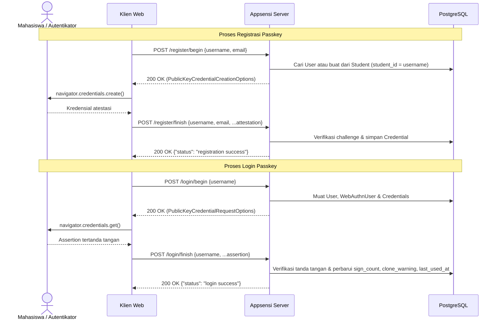
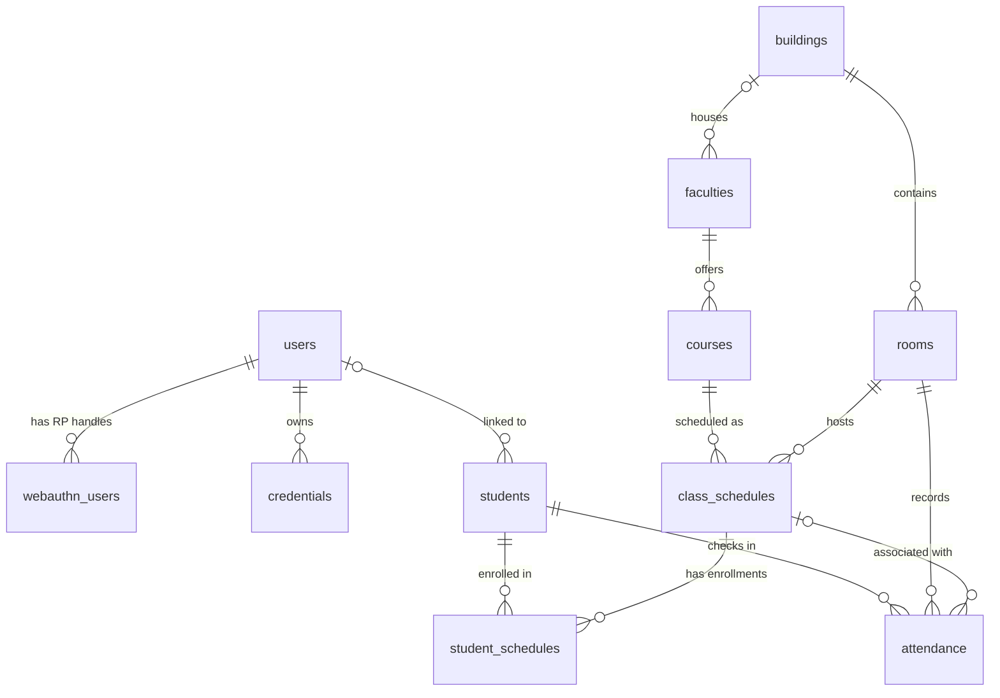

# Appsensi Server

[English](README.md) | **Bahasa Indonesia**

[](go.mod)
[](https://github.com/gin-gonic/gin)
[](https://gorm.io/)
[](https://github.com/go-webauthn/webauthn)
[](LICENSE)

Server REST API backend untuk **Appsensi**, platform presensi akademik kampus yang dibangun menggunakan Go, Gin, PostgreSQL (GORM), serta autentikasi tanpa kata sandi (*passwordless*) berbasis **WebAuthn / Passkey**.

---

## Fitur Utama

- **Autentikasi Passkey Tanpa Kata Sandi**: Mendukung alur registrasi dan login WebAuthn secara penuh menggunakan `go-webauthn`, dilengkapi *resident key*, petunjuk autentikator *cross-platform*/*hybrid*, pencegahan duplikasi kredensial perangkat, pelacakan `sign_count`, dan deteksi kloning kredensial (`clone_warning`).
- **Registrasi Terintegrasi Data Mahasiswa**: Secara otomatis membuat akun pengguna (`users`) berdasarkan data mahasiswa terverifikasi (`students.student_id`) saat pendaftaran passkey pertama kali.
- **Validasi Origin Terpadu (CORS & WebAuthn)**: Konfigurasi `ALLOWED_ORIGINS` digunakan bersama oleh middleware CORS Gin (mendukung kredensial & *preflight* `OPTIONS`) serta daftar `RPOrigins` pada WebAuthn.
- **Model Data Akademik & Presensi**: Skema PostgreSQL berbasis GORM yang mencakup gedung, ruangan, fakultas, mata kuliah, jadwal kelas, pengambilan jadwal mahasiswa (*KRS*), hingga pencatatan kehadiran.

## Tumpukan Teknologi (*Tech Stack*)

| Komponen | Teknologi | Versi |
| :--- | :--- | :--- |
| Bahasa Pemrograman | [Go](https://go.dev/) | `1.27.0` |
| Framework HTTP | [Gin](https://github.com/gin-gonic/gin) | `v1.12.0` |
| Autentikasi | [go-webauthn/webauthn](https://github.com/go-webauthn/webauthn) | `v0.18.2` |
| ORM & Driver Database | [GORM](https://gorm.io/) + `gorm.io/driver/postgres` | `v1.31.2` / `v1.6.3` |
| Generator UUID | [google/uuid](https://github.com/google/uuid) | `v1.6.0` |

## Struktur Proyek

```text
appsensi-server/
├── config/
│   ├── cors.go          # Parser ALLOWED_ORIGINS & middleware CORS Gin
│   ├── cors_test.go     # Unit test untuk preflight CORS & parsing origin
│   └── webauthn.go      # Inisialisasi Relying Party go-webauthn
├── controllers/
│   └── auth.go          # Handler registrasi/login WebAuthn & penyimpanan sesi di memori
├── database/
│   └── db.go            # Konfigurasi koneksi PostgreSQL dengan GORM
├── models/
│   ├── academic.go      # Model Building, Room, Faculty, Course, ClassSchedule
│   ├── schema_test.go   # Unit test kesesuaian nama kolom GORM dengan tag JSON
│   ├── student.go       # Model Student, StudentSchedule, Attendance
│   └── user.go          # Model User, WebAuthnUser, Credential (implementasi webauthn.User)
├── LICENSE              # Lisensi MIT
├── README.id.md         # Dokumentasi Bahasa Indonesia
├── README.md            # Dokumentasi Bahasa Inggris (default)
├── go.mod
├── go.sum
└── main.go              # Titik masuk aplikasi & definisi rute HTTP
```

---

## Memulai (*Getting Started*)

### Prasyarat

- **Go** `1.27` atau lebih baru
- **PostgreSQL** `13` atau lebih baru (menggunakan fungsi bawaan `gen_random_uuid()` untuk *primary key* bertipe UUID)
- Peramban (*browser*) yang mendukung WebAuthn dan diakses melalui `http://localhost` (atau HTTPS pada lingkungan produksi)

### Variabel Lingkungan (*Environment Variables*)

| Variabel | Nilai Bawaan (*Default*) | Deskripsi |
| :--- | :--- | :--- |
| `PORT` | `8080` | Port tempat server HTTP berjalan. |
| `DATABASE_URL` | *(fallback dev lokal di `database/db.go`)* | String koneksi / DSN PostgreSQL (contoh: `host=localhost user=postgres password=<password> dbname=appsensi port=5432 sslmode=disable TimeZone=Asia/Jakarta` atau `postgres://...`). |
| `ALLOWED_ORIGINS` | `http://localhost:3000` | Daftar origin frontend yang dipisahkan koma untuk izin CORS sekaligus `RPOrigins` WebAuthn (spasi berlebih dan garis miring di akhir karakter otomatis dibersihkan). |

> [!IMPORTANT]
> **Catatan Pengembangan Lokal**
> 1. **Migrasi Skema Database**: Blok `db.AutoMigrate(...)` di `database/db.go` dinonaktifkan (dikomentari) secara bawaan karena mengasumsikan skema tabel PostgreSQL sudah tersedia. Untuk database lokal yang masih kosong, jalankan skema SQL Anda terlebih dahulu atau aktifkan sementara blok `AutoMigrate` di `database/db.go`.
> 2. **Prasyarat Data Mahasiswa (`students`)**: Saat mendaftarkan `username` baru pertama kali, endpoint `POST /register/begin` mencari baris pada tabel `students` dengan `student_id = username` untuk membuat akun di tabel `users` dan mengisi `display_name` dari `students.name`. Pastikan data mahasiswa tersebut sudah ada di tabel `students` sebelum melakukan registrasi.
> 3. **Konfigurasi `RPID` WebAuthn & Penyimpanan Sesi**: `RPID` saat ini disetel ke `"localhost"` di `config/webauthn.go`. Akses aplikasi frontend lokal menggunakan `http://localhost:<port>` (bukan `127.0.0.1`) agar validasi domain WebAuthn di peramban berhasil. Sesi tantangan (*challenge*) registrasi/login disimpan di peta memori (*in-memory map*) pada `controllers/auth.go`.

### Instalasi & Menjalankan Server

1. **Kloning repositori dan unduh dependensi**:
   ```bash
   git clone https://github.com/hapnan/appsensi-server.git
   cd appsensi-server
   go mod download
   ```

2. **Atur variabel lingkungan lalu jalankan server**:

   **PowerShell (Windows)**
   ```powershell
   $env:PORT = "8080"
   $env:DATABASE_URL = "host=localhost user=postgres password=<password> dbname=appsensi port=5432 sslmode=disable TimeZone=Asia/Jakarta"
   $env:ALLOWED_ORIGINS = "http://localhost:3000"
   go run main.go
   ```

   **Bash (Linux / macOS)**
   ```bash
   export PORT="8080"
   export DATABASE_URL="host=localhost user=postgres password=<password> dbname=appsensi port=5432 sslmode=disable TimeZone=Asia/Jakarta"
   export ALLOWED_ORIGINS="http://localhost:3000"
   go run main.go
   ```

3. **Pastikan server sudah aktif**:
   ```bash
   curl http://localhost:8080/ping
   # {"message":"pong"}
   ```

---

## Alur Autentikasi & Referensi API

### Diagram Urutan Registrasi & Login Passkey



### Ringkasan Endpoint

| Metode | Path | Deskripsi |
| :--- | :--- | :--- |
| `GET` | `/ping` | Pemeriksaan status server (*health check*), mengembalikan `{"message": "pong"}`. |
| `POST` | `/register/begin` | Menghasilkan opsi pembuatan kredensial WebAuthn untuk mahasiswa. |
| `POST` | `/register/finish` | Memverifikasi respons atestasi dan menyimpan kredensial passkey ke database. |
| `POST` | `/login/begin` | Menghasilkan opsi tantangan (*assertion*) login WebAuthn bagi pengguna terdaftar. |
| `POST` | `/login/finish` | Memverifikasi tanda tangan *assertion* dan memperbarui metadata penggunaan kredensial. |

### Detail Endpoint

#### `GET /ping`
Memeriksa apakah server berjalan normal.
- **Respons (`200 OK`)**:
  ```json
  {
    "message": "pong"
  }
  ```

#### `POST /register/begin`
Memulai sesi registrasi WebAuthn. Membuat baris `users` (ditautkan berdasarkan `username` ke `students.student_id`) serta handle `webauthn_users` apabila belum tersedia, sekaligus mengecualikan kredensial perangkat yang sudah pernah didaftarkan pengguna tersebut.
- **Body Permintaan**:
  ```json
  {
    "username": "20260001",
    "email": "mahasiswa@example.edu"
  }
  ```
- **Respons (`200 OK`)**: JSON standar `CredentialCreation` WebAuthn (`{ "publicKey": { ... } }`).

#### `POST /register/finish`
Menyelesaikan proses registrasi passkey. Mengharapkan satu objek JSON yang memuat **`username` dan `email` di level teratas (*top-level*)** digabung langsung dengan respons atestasi `PublicKeyCredential` dari peramban.
- **Body Permintaan**:
  ```json
  {
    "username": "20260001",
    "email": "mahasiswa@example.edu",
    "id": "<base64url-credential-id>",
    "rawId": "<base64url-credential-id>",
    "type": "public-key",
    "response": {
      "attestationObject": "<base64url>",
      "clientDataJSON": "<base64url>"
    }
  }
  ```
- **Respons (`200 OK`)**:
  ```json
  {
    "status": "registration success"
  }
  ```

#### `POST /login/begin`
Memulai proses login WebAuthn untuk pengguna yang sudah terdaftar tanpa membuat baris baru di database.
- **Body Permintaan**:
  ```json
  {
    "username": "20260001"
  }
  ```
- **Respons (`200 OK`)**: JSON standar `CredentialAssertion` WebAuthn (`{ "publicKey": { ... } }`).
- **Error (`404 Not Found`)**: Dikembalikan jika pengguna belum terdaftar atau belum memiliki handle WebAuthn untuk `RPID` aktif.

#### `POST /login/finish`
Menyelesaikan autentikasi passkey. Mengharapkan **`username` di level teratas** digabung dengan respons *assertion* `PublicKeyCredential` dari peramban. Memperbarui kolom `sign_count`, `clone_warning`, dan `last_used_at` pada kredensial terkait.
- **Body Permintaan**:
  ```json
  {
    "username": "20260001",
    "id": "<base64url-credential-id>",
    "rawId": "<base64url-credential-id>",
    "type": "public-key",
    "response": {
      "authenticatorData": "<base64url>",
      "clientDataJSON": "<base64url>",
      "signature": "<base64url>",
      "userHandle": "<base64url>"
    }
  }
  ```
- **Respons (`200 OK`)**:
  ```json
  {
    "status": "login success",
    "message": "User authenticated successfully"
  }
  ```

### Perilaku Middleware CORS

- Origin yang terdaftar di `ALLOWED_ORIGINS` akan menerima header `Access-Control-Allow-Origin: <origin>` serta `Access-Control-Allow-Credentials: true`.
- Permintaan *preflight* `OPTIONS` dari origin yang diizinkan (atau tanpa header `Origin`) dibalas dengan status `204 No Content`.
- Permintaan *preflight* `OPTIONS` dari origin yang tidak diizinkan ditolak dengan status `403 Forbidden`.

---

## Skema Database

### Diagram Relasi Entitas (*ER Diagram*)



### Ringkasan Tabel

#### Autentikasi & Passkey (`models/user.go`)

| Tabel | Model | Kegunaan |
| :--- | :--- | :--- |
| `users` | `User` | Tabel akun utama (`id`, `email`, `username`, `display_name`), mengimplementasikan antarmuka `webauthn.User`. |
| `webauthn_users` | `WebAuthnUser` | Menyimpan `handle` biner 32-byte WebAuthn pengguna yang unik untuk setiap pasangan `(rp_id, user_id)`. |
| `credentials` | `Credential` | Menyimpan kunci publik passkey, `aaguid`, metadata atestasi, `transport`, `flags`, `sign_count`, `clone_warning`, dan `last_used_at`. |

#### Akademik & Presensi (`models/academic.go`, `models/student.go`)

| Tabel | Model | Kegunaan |
| :--- | :--- | :--- |
| `buildings` | `Building` | Data gedung kampus (`code`, `name`, `purpose`, `has_classes`, `total_floors`). |
| `rooms` | `Room` | Ruang kelas dan fasilitas yang terhubung ke `building_id` (`code`, `floor`, `room_number`, `capacity`). |
| `faculties` | `Faculty` | Data fakultas (`code`, `name`), dengan relasi opsional ke `building_id`. |
| `courses` | `Course` | Mata kuliah yang diselenggarakan fakultas (`code`, `name`, `credits`, `description`, `faculty_id`). |
| `class_schedules` | `ClassSchedule` | Jadwal kelas per sesi/seksi (`course_id`, `room_id`, `section`, `instructor`, `day_of_week`, `start_time`, `end_time`, `academic_term`). |
| `students` | `Student` | Data induk mahasiswa (`student_id`, `name`, `department`, `photo_url`, serta `user_id` opsional). |
| `student_schedules` | `StudentSchedule` | Tabel relasi pengambilan jadwal kelas oleh mahasiswa (`status`, `enrolled_at`). |
| `attendance` | `Attendance` | Catatan kehadiran harian mahasiswa per ruangan/sesi (`student_id`, `room_id`, `class_schedule_id` opsional, `session_date`, `checked_in_at`). |

---

## Pengujian (*Testing*)

Jalankan seluruh *unit test* tanpa memerlukan koneksi database PostgreSQL aktif:

```bash
go test -v ./...
```

Cakupan pengujian saat ini meliputi:
- **`config/cors_test.go`**: Pengujian parsing `ALLOWED_ORIGINS` (normalisasi spasi dan garis miring penutup) serta perilaku middleware CORS untuk origin yang diizinkan, header kredensial, dan penolakan *preflight* dari origin asing.
- **`models/schema_test.go`**: Memastikan setiap nama kolom GORM pada seluruh 11 model sesuai dengan tag `json`-nya (termasuk *override* kolom eksplisit seperti `Credential.AAGUID` -> `aaguid` dan `WebAuthnUser.RpID` -> `rp_id`).

---

## Lisensi

Didistribusikan di bawah [Lisensi MIT](LICENSE).
