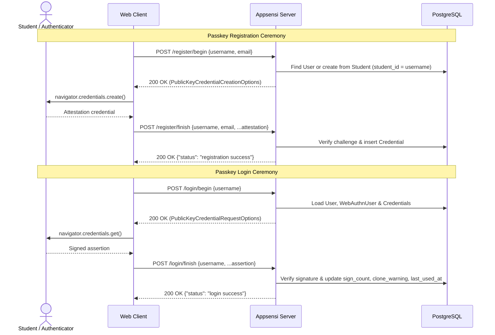
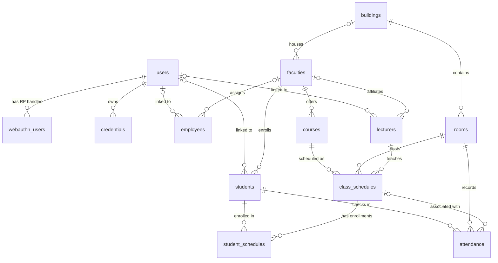

# Appsensi Server

**English** | [Bahasa Indonesia](README.id.md)

[](go.mod)
[](https://github.com/gin-gonic/gin)
[](https://gorm.io/)
[](https://github.com/go-webauthn/webauthn)
[](LICENSE)

Backend REST API server for **Appsensi**, a campus academic attendance platform built with Go, Gin, PostgreSQL (GORM), and passwordless **WebAuthn / Passkey** authentication.

---

## Features

- **Passwordless Passkey Authentication**: Full WebAuthn registration and assertion ceremonies powered by `go-webauthn`, configured with resident keys, cross-platform/hybrid authenticator hints, duplicate-credential exclusion, sign-count tracking, and credential clone detection.
- **Student, Employee & Lecturer Passkey Onboarding**: Automatically provisions user accounts (`users.user_type`: `student`, `employee`, or `lecturer`) from verified `students`, `employees`, or `lecturers` records during initial passkey registration.
- **Role-Scoped Campus Dashboards**: Dedicated `/dashboard/*` APIs with role-based access control for **Finance** (`finance`), **Academic Affairs** (`academic_affairs`), **Student Affairs** (`student_affairs`, scoped to an assigned `faculty_id`), and **Lecturers** (`lecturer`).
- **Origin-Aware CORS & RP Validation**: Unified `ALLOWED_ORIGINS` configuration shared between Gin's CORS middleware (with credentials & preflight support) and WebAuthn Relying Party origin verification.
- **Academic & Attendance Data Model**: Strongly typed PostgreSQL GORM models covering campus buildings, rooms, faculties, courses, lecturers, employees, class schedules, student enrollments, and room/session attendance records.

## Tech Stack

| Layer | Technology | Version |
| :--- | :--- | :--- |
| Language | [Go](https://go.dev/) | `1.27.0` |
| HTTP Framework | [Gin](https://github.com/gin-gonic/gin) | `v1.12.0` |
| Authentication | [go-webauthn/webauthn](https://github.com/go-webauthn/webauthn) | `v0.18.2` |
| ORM & Database Driver | [GORM](https://gorm.io/) + `gorm.io/driver/postgres` | `v1.31.2` / `v1.6.3` |
| Identifiers | [google/uuid](https://github.com/google/uuid) | `v1.6.0` |

## Project Structure

```text
appsensi-server/
├── config/
│   ├── cors.go              # ALLOWED_ORIGINS parser & Gin CORS middleware
│   ├── cors_test.go         # Unit tests for CORS preflight & origin parsing
│   ├── mds.go               # FIDO Conformance static + dynamic MDS3 metadata provider
│   ├── mds_test.go          # Unit tests for local MDS loading, MDS3 JWT/x5u/CRL & refresh
│   └── webauthn.go          # go-webauthn Relying Party & Conformance initialization
├── controllers/
│   ├── attendance.go                     # Room catalog, live session roster & attendance check-in handlers
│   ├── attendance_test.go                # Unit tests for attendance catalog, roster & check-in flows
│   ├── auth.go                           # Production WebAuthn registration/login handlers
│   ├── auth_test.go                      # Unit tests for production WebAuthn ceremonies & session safety
│   ├── conformance.go                    # Standardized FIDO2 Conformance Server endpoints
│   ├── conformance_test.go               # End-to-end conformance ceremony & validation tests
│   ├── dashboard_academic.go             # Academic Affairs dashboard summary & CRUD handlers
│   ├── dashboard_academic_test.go        # Unit tests for Academic Affairs dashboard handlers
│   ├── dashboard_auth.go                 # Passkey session store, identity resolution & RBAC helpers
│   ├── dashboard_finance.go              # Finance dashboard summary & enrolled-credits directory handlers
│   ├── dashboard_finance_test.go         # Unit tests for Finance dashboard handlers
│   ├── dashboard_lecturer.go             # Lecturer dashboard schedules, rosters & session attendance handlers
│   ├── dashboard_lecturer_test.go        # Unit tests for Lecturer dashboard handlers
│   ├── dashboard_student_affairs.go      # Faculty-scoped Student Affairs dashboard CRUD, KRS & attendance handlers
│   ├── dashboard_student_affairs_test.go # Unit tests for Student Affairs dashboard handlers
│   ├── registration.go                   # Student/employee/lecturer registration lists, user linking & cleanup
│   ├── registration_test.go              # Unit tests for registration directory, linking & cleanup flows
│   ├── sql_optimization_test.go          # SQL query shape & index optimization verification tests
│   └── types.go                          # Shared typed API error/status envelopes & RoomCode/SessionDate value types
├── database/
│   ├── db.go                # PostgreSQL GORM connection setup
│   ├── migrate.go           # Opt-in schema & index auto-migration with SHA-256 fingerprint tracking
│   ├── migrate_test.go      # Unit tests for schema fingerprint & migration helpers
│   └── optimize_indexes.sql # Composite & partial PostgreSQL indexes for hot query paths
├── fido-conformance-mds/    # FIDO Alliance conformance authenticator metadata JSON statements
├── models/
│   ├── academic.go      # Building, Room, Faculty, Course, ClassSchedule models
│   ├── schema_test.go   # Unit tests verifying GORM column-to-JSON tag alignment
│   ├── staff.go         # Employee (finance, academic_affairs, student_affairs) & Lecturer models
│   ├── student.go       # Student, StudentSchedule, Attendance models
│   └── user.go          # User, WebAuthnUser, Credential models (implements webauthn.User)
├── LICENSE              # MIT License
├── README.id.md         # Bahasa Indonesia documentation
├── README.md            # English documentation (default)
├── go.mod
├── go.sum
└── main.go              # Application entry point & HTTP route definitions
```

---

## Getting Started

### Prerequisites

- **Go** `1.27` or newer
- **PostgreSQL** `13` or newer (uses built-in `gen_random_uuid()` for UUID primary keys)
- A WebAuthn-capable browser accessed over `http://localhost` (or HTTPS in production)

### Environment Variables

| Variable | Default | Description |
| :--- | :--- | :--- |
| `PORT` | `8080` | Port the HTTP server listens on. |
| `DATABASE_URL` | *(local dev fallback in `database/db.go`)* | PostgreSQL connection string / DSN (e.g., `host=localhost user=postgres password=<password> dbname=appsensi port=5432 sslmode=disable TimeZone=Asia/Jakarta` or `postgres://...`). |
| `ALLOWED_ORIGINS` | `http://localhost:3000` | Comma-separated list of frontend origins permitted by both CORS and WebAuthn `RPOrigins` (trailing slashes and whitespace are trimmed automatically). |
| `DB_AUTO_MIGRATE` | `false` | Set to `true` to run GORM `AutoMigrate` and index creation automatically whenever model schemas or index definitions change (tracked via SHA-256 fingerprint in `app_schema_meta`). |
| `DB_MAX_OPEN_CONNS` | `20` | Maximum open PostgreSQL connections in `sql.DB` pool. |
| `DB_MAX_IDLE_CONNS` | `10` | Maximum idle PostgreSQL connections retained in `sql.DB` pool (clamped to `DB_MAX_OPEN_CONNS`). |
| `DB_SIMPLE_PROTOCOL` | `false` | Set to `true` when connecting through a transaction-mode connection pooler (e.g., PgBouncer / Supavisor) to disable `pgx` extended-protocol statement caching. |

> [!IMPORTANT]
> **Local Development Notes**
> 1. **Database Migrations**: Automatic schema migration is opt-in (`DB_AUTO_MIGRATE=false` by default). Set `DB_AUTO_MIGRATE=true` to apply model/index migrations automatically when schema changes are detected, or apply your SQL schema and `database/optimize_indexes.sql` manually.
> 2. **Directory Record Prerequisite**: When registering a username for the first time, `POST /register/begin` queries `students` (`student_id = username`), `employees` (`employee_id = username`), or `lecturers` (`lecturer_id = username`) to create the `users` row (`user_type`: `student`, `employee`, or `lecturer`) and populate `display_name`. Seed a matching record in `students`, `employees`, or `lecturers` before registering a new user.
> 3. **WebAuthn `RPID` & Challenge Sessions**: `RPID` is currently set to `"localhost"` in `config/webauthn.go`. Open your frontend client via `http://localhost:<port>` (not `127.0.0.1`) so browser WebAuthn validation succeeds. Active registration/login challenges are kept in an in-memory map in `controllers/auth.go`.

### Installation & Running

1. **Clone the repository and install dependencies**:
   ```bash
   git clone https://github.com/hapnan/appsensi-server.git
   cd appsensi-server
   go mod download
   ```

2. **Configure environment variables and start the server**:

   **PowerShell (Windows)**
   ```powershell
   $env:PORT = "8080"
   $env:DATABASE_URL = "host=localhost user=postgres password=<password> dbname=appsensi port=5432 sslmode=disable TimeZone=Asia/Jakarta"
   $env:ALLOWED_ORIGINS = "http://localhost:3000"
   go run main.go
   ```

   **Bash (Linux / macOS)**
   ```bash
   export PORT="8080"
   export DATABASE_URL="host=localhost user=postgres password=<password> dbname=appsensi port=5432 sslmode=disable TimeZone=Asia/Jakarta"
   export ALLOWED_ORIGINS="http://localhost:3000"
   go run main.go
   ```

3. **Verify the server is running**:
   ```bash
   curl http://localhost:8080/ping
   # {"message":"pong"}
   ```

---

## Authentication Flow & API Reference

### Passkey Registration & Login Sequence



### Endpoints Summary

| Method | Path | Description |
| :--- | :--- | :--- |
| `GET` | `/ping` | Health check endpoint returning `{"message": "pong"}`. |
| `POST` | `/register/begin` | Generates WebAuthn credential creation options for a student, employee, or lecturer. |
| `POST` | `/register/finish` | Verifies attestation response, stores the passkey credential, and links the account. |
| `POST` | `/login/begin` | Generates WebAuthn assertion options for an existing registered user. |
| `POST` | `/login/finish` | Verifies signed assertion, updates credential usage metadata, and issues a passkey session token. |
| `GET` | `/attendance/demo-catalog` | Lists classrooms with scheduled courses and weekly sessions. |
| `GET` | `/attendance/roster` | Returns the active class session and pending student roster for a room/date. |
| `POST` | `/attendance/check-in` | Records verified student attendance for a room's active class session. |
| `GET` | `/registration/list` | Lists all students paired with WebAuthn account & passkey status. |
| `POST` | `/registration/link-student` | Links `students.user_id` to `users.id` (idempotent). |
| `GET` | `/registration/employees` | Lists all employees paired with role, faculty, and passkey registration status. |
| `POST` | `/registration/link-employee` | Links `employees.user_id` to `users.id` (idempotent). |
| `GET` | `/registration/lecturers` | Lists all lecturers paired with faculty and passkey registration status. |
| `POST` | `/registration/link-lecturer` | Links `lecturers.user_id` to `users.id` (idempotent). |
| `POST` | `/registration/cleanup-incomplete` | Deletes an incomplete `users` record that has zero passkey credentials. |
| `GET` | `/dashboard/me` | Resolves the authenticated user's profile, `userType`, `jobRole`, and `facultyId`. |
| `GET` | `/dashboard/finance/summary` | Campus-wide and per-faculty student enrollment & credit totals (`finance` role). |
| `GET` | `/dashboard/finance/students` | Lists students with enrolled course/credit counts (`finance` role). |
| `GET` | `/dashboard/academic/summary` | Campus-wide counts of faculties, buildings, rooms, courses, staff, schedules & students (`academic_affairs` role). |
| `GET` | `/dashboard/academic/faculties` | Lists all faculties (`academic_affairs` role). |
| `POST` | `/dashboard/academic/faculties` | Creates a new faculty (`academic_affairs` role). |
| `PUT` | `/dashboard/academic/faculties/:id` | Updates an existing faculty (`academic_affairs` role). |
| `GET` | `/dashboard/academic/courses` | Lists courses with optional `facultyId` filter (`academic_affairs` role). |
| `POST` | `/dashboard/academic/courses` | Creates a new course (`academic_affairs` role). |
| `PUT` | `/dashboard/academic/courses/:id` | Updates an existing course (`academic_affairs` role). |
| `DELETE` | `/dashboard/academic/courses/:id` | Deletes a course (`academic_affairs` role). |
| `GET` | `/dashboard/academic/lecturers` | Lists lecturers with optional `facultyId` filter (`academic_affairs` role). |
| `POST` | `/dashboard/academic/lecturers` | Creates a new lecturer (`academic_affairs` role). |
| `PUT` | `/dashboard/academic/lecturers/:id` | Updates an existing lecturer (`academic_affairs` role). |
| `DELETE` | `/dashboard/academic/lecturers/:id` | Deletes a lecturer (`academic_affairs` role). |
| `GET` | `/dashboard/academic/employees` | Lists employees with optional `jobRole` and `facultyId` filters (`academic_affairs` role). |
| `POST` | `/dashboard/academic/employees` | Creates a new employee (`academic_affairs` role). |
| `PUT` | `/dashboard/academic/employees/:id` | Updates an existing employee (`academic_affairs` role). |
| `DELETE` | `/dashboard/academic/employees/:id` | Deletes an employee (`academic_affairs` role). |
| `GET` | `/dashboard/academic/schedules` | Lists class schedules with optional `courseId`, `lecturerId`, and `academicTerm` filters (`academic_affairs` role). |
| `POST` | `/dashboard/academic/schedules` | Creates a new class schedule (`academic_affairs` role). |
| `PUT` | `/dashboard/academic/schedules/:id` | Updates an existing class schedule (`academic_affairs` role). |
| `DELETE` | `/dashboard/academic/schedules/:id` | Deletes a class schedule (`academic_affairs` role). |
| `GET` | `/dashboard/student-affairs/summary` | Faculty-scoped student, course, enrollment & attendance counts (`student_affairs` role). |
| `GET` | `/dashboard/student-affairs/students` | Lists students in the employee's assigned faculty (`student_affairs` role). |
| `POST` | `/dashboard/student-affairs/students` | Creates a student in the employee's assigned faculty (`student_affairs` role). |
| `PUT` | `/dashboard/student-affairs/students/:id` | Updates a student in the employee's assigned faculty (`student_affairs` role). |
| `DELETE` | `/dashboard/student-affairs/students/:id` | Deletes a student in the employee's assigned faculty (`student_affairs` role). |
| `GET` | `/dashboard/student-affairs/students/:id/schedules` | Lists enrolled class schedules for a faculty student (`student_affairs` role). |
| `POST` | `/dashboard/student-affairs/students/:id/schedules` | Enrolls a faculty student into a class schedule (`student_affairs` role). |
| `DELETE` | `/dashboard/student-affairs/students/:id/schedules/:scheduleId` | Drops a class schedule enrollment for a faculty student (`student_affairs` role). |
| `GET` | `/dashboard/student-affairs/attendance` | Lists attendance records for students in the employee's faculty (`student_affairs` role). |
| `GET` | `/dashboard/lecturer/summary` | Summary of assigned schedules, enrolled students & attendances (`lecturer` account). |
| `GET` | `/dashboard/lecturer/schedules` | Lists class schedules assigned to the authenticated lecturer (`lecturer` account). |
| `GET` | `/dashboard/lecturer/schedules/:scheduleId/students` | Lists students enrolled in an owned class schedule (`lecturer` account). |
| `GET` | `/dashboard/lecturer/schedules/:scheduleId/attendance` | Returns the session attendance sheet for an owned schedule and date (`lecturer` account). |
| `POST` | `/dashboard/lecturer/schedules/:scheduleId/attendance` | Manually records student attendance for an owned schedule (`lecturer` account). |
| `DELETE` | `/dashboard/lecturer/schedules/:scheduleId/attendance/:studentId` | Removes a student attendance record for an owned schedule on a given `date` (`lecturer` account). |

### Endpoint Details

#### `GET /ping`
Returns server liveness status.
- **Response (`200 OK`)**:
  ```json
  {
    "message": "pong"
  }
  ```

#### `POST /register/begin`
Starts a WebAuthn registration session. Creates a `users` record (linked by `username` to `students.student_id`) and a `webauthn_users` handle if not already present, excluding any credentials already registered to the user.
- **Request Body**:
  ```json
  {
    "username": "20260001",
    "email": "student@example.edu"
  }
  ```
- **Response (`200 OK`)**: Standard WebAuthn `CredentialCreation` JSON (`{ "publicKey": { ... } }`).

#### `POST /register/finish`
Completes passkey registration. Expects a single JSON object containing **`username` and `email` at the top level** merged with the browser's WebAuthn `PublicKeyCredential` attestation response, and automatically links `students.user_id` to `users.id` when unset.
- **Request Body**:
  ```json
  {
    "username": "20260001",
    "email": "student@example.edu",
    "id": "<base64url-credential-id>",
    "rawId": "<base64url-credential-id>",
    "type": "public-key",
    "response": {
      "attestationObject": "<base64url>",
      "clientDataJSON": "<base64url>"
    }
  }
  ```
- **Response (`200 OK`)**:
  ```json
  {
    "status": "registration success"
  }
  ```

#### `POST /login/begin`
Starts a WebAuthn login ceremony for an already-registered user without creating new database rows.
- **Request Body**:
  ```json
  {
    "username": "20260001"
  }
  ```
- **Response (`200 OK`)**: Standard WebAuthn `CredentialAssertion` JSON (`{ "publicKey": { ... } }`).
- **Error (`404 Not Found`)**: Returned if the user does not exist or has no WebAuthn handle for the current `RPID`.

#### `POST /login/finish`
Completes passkey authentication. Expects **`username` at the top level** merged with the browser's WebAuthn `PublicKeyCredential` assertion response. Updates `sign_count`, `clone_warning`, and `last_used_at` on the matched credential.
- **Request Body**:
  ```json
  {
    "username": "20260001",
    "id": "<base64url-credential-id>",
    "rawId": "<base64url-credential-id>",
    "type": "public-key",
    "response": {
      "authenticatorData": "<base64url>",
      "clientDataJSON": "<base64url>",
      "signature": "<base64url>",
      "userHandle": "<base64url>"
    }
  }
  ```
- **Response (`200 OK`)**:
  ```json
  {
    "status": "login success",
    "message": "User authenticated successfully"
  }
  ```

#### `GET /attendance/demo-catalog`
Lists all campus classrooms that host scheduled courses along with their weekly class sessions, sorted by building, floor, and room number.
- **Response (`200 OK`)**: `DemoCatalogRoom[]` (`code`, `floor`, `roomNumber`, `buildingCode`, `buildingName`, `facultyCode`, `facultyName`, `schedules`).

#### `GET /attendance/roster`
Returns the active class schedule and students enrolled in it who still need to check in on the target date.
- **Query Parameters**:
  - `room` *(required)*: Room code in `building.floor.room` format (e.g. `h.2.4`, case-insensitive).
  - `scheduleId` *(optional)*: Explicit `class_schedules.id` UUID to select a specific session on that day.
  - `date` *(optional)*: Calendar date in `YYYY-MM-DD` format (defaults to server today).
- **Response (`200 OK`)**: `RosterResult` (`room`, `sessionDate`, `dayOfWeek`, `schedule`, `availableSchedules`, `total`, `present`, `pending`).
- **Error (`400 Bad Request`)**: Returned if `room`, `scheduleId`, or `date` is malformed.

#### `POST /attendance/check-in`
Records a student's attendance in `attendance` for a room's active class schedule.
- **Request Body**:
  ```json
  {
    "room": "h.2.4",
    "studentId": "STU-FCS-001",
    "scheduleId": "<optional-uuid>",
    "date": "2026-11-04"
  }
  ```
- **Response (`200 OK`)**:
  ```json
  {
    "id": "<student-uuid>",
    "studentId": "STU-FCS-001",
    "name": "Student Name",
    "room": "h.2.4",
    "sessionDate": "2026-11-04",
    "checkedInAt": "2026-11-04T09:15:00Z"
  }
  ```
- **Errors**: `400 Bad Request` (invalid input or student not enrolled), `404 Not Found` (room or student missing), `412 Precondition Failed` (no passkey registered or no class scheduled), `409 Conflict` (already checked in).

#### `GET /registration/list`
Lists all students ordered by `student_id` paired with any linked `users` account and passkey registration status (`isRegistered`).
- **Response (`200 OK`)**: `RegistrationStudentRow[]` (`id`, `name`, `username`, `department`, `userId`, `email`, `createdAt`, `isRegistered`).

#### `POST /registration/link-student`
Idempotently links `students.user_id` to `users.id` for a registered username.
- **Request Body**: `{ "studentId": "<student-uuid>", "username": "STU-FCS-001" }`
- **Response (`200 OK`)**: `{ "userId": "<user-uuid>", "email": "student@example.edu", "createdAt": "..." }`
- **Errors**: `400 Bad Request`, `404 Not Found`.

#### `GET /registration/employees`
Lists all employees ordered by `employee_id` paired with their `jobRole` (`finance`, `academic_affairs`, `student_affairs`), faculty metadata, linked `users` account, and passkey registration status (`isRegistered`).
- **Response (`200 OK`)**: `RegistrationEmployeeRow[]` (`id`, `name`, `username`, `department`, `jobRole`, `facultyId`, `facultyCode`, `facultyName`, `userId`, `email`, `createdAt`, `isRegistered`).

#### `POST /registration/link-employee`
Idempotently links `employees.user_id` to `users.id` for a registered employee username.
- **Request Body**: `{ "employeeId": "<employee-uuid>", "username": "EMP-FIN-001" }`
- **Response (`200 OK`)**: `{ "userId": "<user-uuid>", "email": "staff@example.edu", "createdAt": "..." }`
- **Errors**: `400 Bad Request`, `404 Not Found`.

#### `GET /registration/lecturers`
Lists all lecturers ordered by `lecturer_id` paired with their faculty metadata, linked `users` account, and passkey registration status (`isRegistered`).
- **Response (`200 OK`)**: `RegistrationLecturerRow[]` (`id`, `name`, `username`, `department`, `facultyId`, `facultyCode`, `facultyName`, `userId`, `email`, `createdAt`, `isRegistered`).

#### `POST /registration/link-lecturer`
Idempotently links `lecturers.user_id` to `users.id` for a registered lecturer username.
- **Request Body**: `{ "lecturerId": "<lecturer-uuid>", "username": "LEC-FCS-001" }`
- **Response (`200 OK`)**: `{ "userId": "<user-uuid>", "email": "lecturer@example.edu", "createdAt": "..." }`
- **Errors**: `400 Bad Request`, `404 Not Found`.

#### `POST /registration/cleanup-incomplete`
Deletes an unverified `users` record (one with zero passkey credentials) and clears any pending registration challenge if a WebAuthn ceremony is cancelled midway.
- **Request Body**: `{ "username": "STU-FCS-001" }`
- **Response (`200 OK`)**: `{ "cleaned": true }` (or `{ "cleaned": false }` if not found or credentials already exist).

#### Dashboard Authentication & Role-Scoped Endpoints (`/dashboard/*`)
All `/dashboard/*` endpoints authenticate callers via `Authorization: Bearer <sessionToken>` or `X-Session-Token` (issued by `POST /login/finish`), or via `X-User-ID` / `X-Username` headers (or `userId` / `username` query parameters).

- **`GET /dashboard/me`**: Returns `DashboardUserContext` (`userId`, `username`, `email`, `displayName`, `userType`, `profileId`, `jobRole`, `department`, `facultyId`, `facultyCode`, `facultyName`).
- **Finance Dashboard (`/dashboard/finance/*` — requires `employee` with `job_role = "finance"`)**:
  - `GET /dashboard/finance/summary` (optional `?academicTerm=`): Returns campus-wide `totalStudents`, `registeredStudents`, `enrolledStudents`, `totalCredits`, `totalFaculties`, and `byFaculty` breakdown.
  - `GET /dashboard/finance/students` (optional `?facultyId=`, `?academicTerm=`, `?search=`): Lists students with `enrolledCourses`, `enrolledCredits`, and `isRegistered`.
- **Academic Affairs Dashboard (`/dashboard/academic/*` — requires `employee` with `job_role = "academic_affairs"`)**:
  - `GET /dashboard/academic/summary`: Returns campus-wide infrastructure and staffing counts.
  - `GET|POST /dashboard/academic/faculties` & `PUT /dashboard/academic/faculties/:id`: Manage faculties.
  - `GET|POST /dashboard/academic/courses` & `PUT|DELETE /dashboard/academic/courses/:id`: Manage courses (filterable by `?facultyId=`).
  - `GET|POST /dashboard/academic/lecturers` & `PUT|DELETE /dashboard/academic/lecturers/:id`: Manage lecturers (filterable by `?facultyId=`).
  - `GET|POST /dashboard/academic/employees` & `PUT|DELETE /dashboard/academic/employees/:id`: Manage employees (filterable by `?jobRole=` & `?facultyId=`; enforces `faculty_id` when `jobRole = "student_affairs"`).
  - `GET|POST /dashboard/academic/schedules` & `PUT|DELETE /dashboard/academic/schedules/:id`: Manage class schedules (filterable by `?courseId=`, `?lecturerId=`, `?academicTerm=`).
- **Student Affairs Dashboard (`/dashboard/student-affairs/*` — requires `employee` with `job_role = "student_affairs"` and a non-null `faculty_id`)**:
  - `GET /dashboard/student-affairs/summary`: Returns student, course, enrollment, and attendance counts for the employee's faculty.
  - `GET|POST /dashboard/student-affairs/students` & `PUT|DELETE /dashboard/student-affairs/students/:id`: Faculty-scoped student CRUD (supports `?search=` & `?department=`).
  - `GET|POST /dashboard/student-affairs/students/:id/schedules` & `DELETE /dashboard/student-affairs/students/:id/schedules/:scheduleId`: Manage student course schedule enrollments (KRS) within the employee's faculty.
  - `GET /dashboard/student-affairs/attendance`: Lists attendance records for students in the employee's faculty (optional `?scheduleId=`, `?studentId=`, `?date=YYYY-MM-DD`).
- **Lecturer Dashboard (`/dashboard/lecturer/*` — requires `lecturer` account)**:
  - `GET /dashboard/lecturer/summary`: Returns schedule, enrollment, and attendance totals for the authenticated lecturer.
  - `GET /dashboard/lecturer/schedules`: Lists class schedules assigned to the lecturer (optional `?academicTerm=`, `?dayOfWeek=`).
  - `GET /dashboard/lecturer/schedules/:scheduleId/students`: Lists enrolled students and attendance counts for an owned schedule.
  - `GET /dashboard/lecturer/schedules/:scheduleId/attendance`: Returns the session attendance sheet (`present` / `absent` per student) for `?date=YYYY-MM-DD`.
  - `POST /dashboard/lecturer/schedules/:scheduleId/attendance`: Manually records attendance (`{ "studentId": "...", "date": "YYYY-MM-DD" }`).
  - `DELETE /dashboard/lecturer/schedules/:scheduleId/attendance/:studentId?date=YYYY-MM-DD`: Deletes a student's attendance record for that session date.

### CORS Behavior

- Configured origins in `ALLOWED_ORIGINS` receive `Access-Control-Allow-Origin: <origin>` and `Access-Control-Allow-Credentials: true`.
- `OPTIONS` preflight requests from allowed origins (or requests without an `Origin` header) respond with `204 No Content`.
- `OPTIONS` preflight requests from unlisted origins are rejected with `403 Forbidden`.

---

## Database Schema

### Entity-Relationship Diagram



### Tables Overview

#### Authentication & Passkeys (`models/user.go`)

| Table | Model | Purpose |
| :--- | :--- | :--- |
| `users` | `User` | Core account table (`id`, `email`, `username`, `display_name`, `user_type` [`student`, `employee`, `lecturer`]), implementing `webauthn.User`. |
| `webauthn_users` | `WebAuthnUser` | Stores the opaque 32-byte WebAuthn user `handle` scoped per `(rp_id, user_id)`. |
| `credentials` | `Credential` | Stores registered passkey public keys, `aaguid`, attestation metadata, transports, flags, `sign_count`, `clone_warning`, and `last_used_at`. |

#### Academic, Staff & Attendance (`models/academic.go`, `models/staff.go`, `models/student.go`)

| Table | Model | Purpose |
| :--- | :--- | :--- |
| `buildings` | `Building` | Campus building metadata (`code`, `name`, `purpose`, `has_classes`, `total_floors`). |
| `rooms` | `Room` | Classrooms and facilities tied to a `building_id` (`code`, `floor`, `room_number`, `capacity`). |
| `faculties` | `Faculty` | Academic faculties (`code`, `name`), optionally associated with a home `building_id`. |
| `courses` | `Course` | Courses offered by a faculty (`code`, `name`, `credits`, `description`, `faculty_id`). |
| `employees` | `Employee` | Campus staff directory (`employee_id`, `name`, `department`, `job_role` [`finance`, `academic_affairs`, `student_affairs`], `faculty_id`, `photo_url`, optional `user_id`). |
| `lecturers` | `Lecturer` | Lecturer directory (`lecturer_id`, `name`, `department`, `faculty_id`, `photo_url`, optional `user_id`). |
| `class_schedules` | `ClassSchedule` | Scheduled course sections (`course_id`, `room_id`, `lecturer_id`, `section`, `instructor`, `day_of_week`, `start_time`, `end_time`, `academic_term`). |
| `students` | `Student` | Student directory (`student_id`, `name`, `department`, `faculty_id`, `photo_url`, optional `user_id`). |
| `student_schedules` | `StudentSchedule` | Join table tracking student enrollments in `class_schedules` (`status`, `enrolled_at`). |
| `attendance` | `Attendance` | Daily student room/session check-in logs (`student_id`, `room_id`, `class_schedule_id`, `session_date`, `checked_in_at`). |

---

## Testing

Run the full unit test suite without requiring a live PostgreSQL instance:

```bash
go test -v ./...
```

Current test suites cover:
- **`config/cors_test.go`**: `ALLOWED_ORIGINS` parsing (whitespace/trailing-slash normalization) and CORS middleware responses for allowed origins, credential headers, and disallowed preflight requests.
- **`config/mds_test.go`**: Loading all 25 FIDO Conformance metadata JSON files (`fido-conformance-mds/`), COSE algorithm support (`ES256K` / `RS1`), zero-AAGUID U2F key-identifier verification, and dynamic MDS3 JWT blob verification (`x5c`, `x5u`, CRL revocation, poisoned blob isolation, and `nextUpdate` refreshes).
- **`controllers/attendance_test.go`**: Classroom demo catalog grouping & sorting, active session selection & roster pending calculation, and full attendance check-in validation & conflict handling.
- **`controllers/auth_test.go`**: Production WebAuthn passkey registration & login ceremonies, ceremony-isolated session enforcement, safe body buffer handling, and unified `APIErrorResponse` envelopes.
- **`controllers/conformance_test.go`**: End-to-end FIDO2 Conformance registration and assertion ceremonies (`/attestation/*`, `/assertion/*`), strict input validation, `getClientExtensionResults` mapping, duplicate credential rejection, and `signCount` regression (`CloneWarning`) rejection.
- **`controllers/registration_test.go`**: Student, employee, and lecturer registration directory listings & credential deduplication, idempotent `user_id` linking, and incomplete user/session cleanup.
- **`controllers/dashboard_finance_test.go`**: Finance role authorization, campus-wide & per-faculty credit summary aggregation, and student credit directory filtering.
- **`controllers/dashboard_academic_test.go`**: Academic Affairs role authorization, summary metrics, and CRUD operations for faculties, courses, lecturers, employees (including `student_affairs` faculty scope validation), and class schedules.
- **`controllers/dashboard_student_affairs_test.go`**: Faculty-scoped Student Affairs role enforcement, student CRUD, student schedule enrollment/drop (KRS), and faculty attendance reporting.
- **`controllers/dashboard_lecturer_test.go`**: Lecturer authorization, schedule ownership verification, enrolled student rosters, session attendance sheets, and manual attendance check-in/deletion.
- **`models/schema_test.go`**: Verifies that every GORM model column name matches its `json` struct tag and aligns UUID foreign keys and composite unique indexes with the PostgreSQL schema.

---

## FIDO2 Conformance Testing

`appsensi-server` includes a dedicated FIDO Alliance Certification Conformance mode gated behind `FIDO_CONFORMANCE=true`. When disabled (the default), only production routes (`/register/*`, `/login/*`) are mounted.

### Conformance Environment Variables

| Variable | Default | Description |
| :--- | :--- | :--- |
| `FIDO_CONFORMANCE` | `false` | Set to `true` to mount `/attestation/options`, `/attestation/result`, `/assertion/options`, and `/assertion/result`. |
| `RP_ID` | `localhost` | Relying Party ID matching the host entered in the FIDO Conformance Tool. |
| `FIDO_MDS_DIR` | `fido-conformance-mds` | Directory containing local FIDO Conformance authenticator metadata `.json` files. |
| `FIDO_MDS3_ENABLED` | `false` | Set to `true` when running the optional **MDS3** dynamic metadata test add-on. |
| `FIDO_CONFORMANCE_ENDPOINT` | `http://localhost:<PORT>` | Server URL sent to `POST /getEndpoints` when `FIDO_MDS3_ENABLED=true` (also added to allowed WebAuthn/CORS origins). |
| `FIDO_MDS3_ENDPOINTS_URL` | `https://mds3.fido.tools/getEndpoints` | Dynamic MDS3 `getEndpoints` URL. |
| `FIDO_MDS3_ROOT_CERT_URL` | `https://mds3.fido.tools/pki/MDS3ROOT.crt` | MDS3 root CA certificate URL (or set `FIDO_MDS3_ROOT_CERT_PATH` for a local file). |

### Running FIDO Conformance Testing Tools

1. **Ensure PostgreSQL is running** with the `users`, `webauthn_users`, and `credentials` tables migrated (no `students` records need to be seeded for conformance tests).
2. **Start the server in conformance mode** (PowerShell):
   ```powershell
   $env:PORT = "8080"
   $env:RP_ID = "localhost"
   $env:FIDO_CONFORMANCE = "true"
   # Optional: enable only when checking the MDS3 add-on in the FIDO Conformance Tool
   # $env:FIDO_MDS3_ENABLED = "true"
   # $env:FIDO_CONFORMANCE_ENDPOINT = "http://localhost:8080"
   go run main.go
   ```
3. **Run the FIDO Conformance Testing Tools desktop application**:
   - Select **FIDO2** -> **Server** test suite.
   - Set **Server URL** to `http://localhost:8080`.
   - Click **RUN**.

---

## License

Distributed under the [MIT License](LICENSE).
