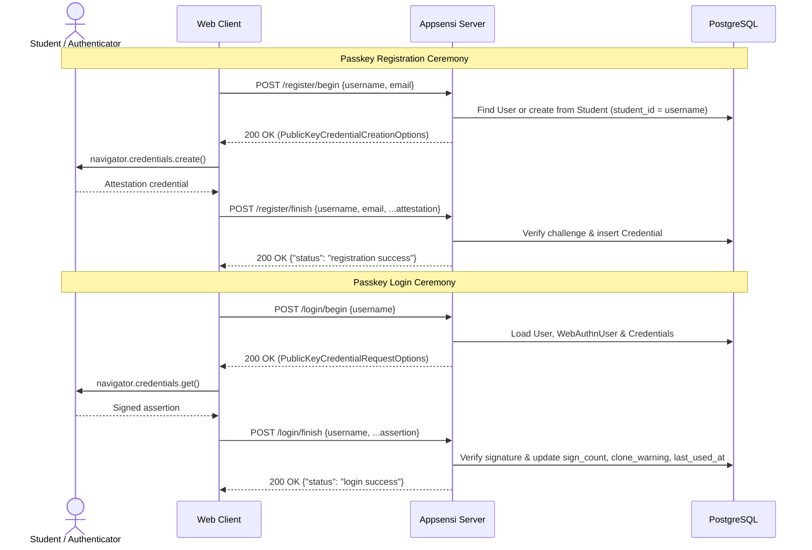
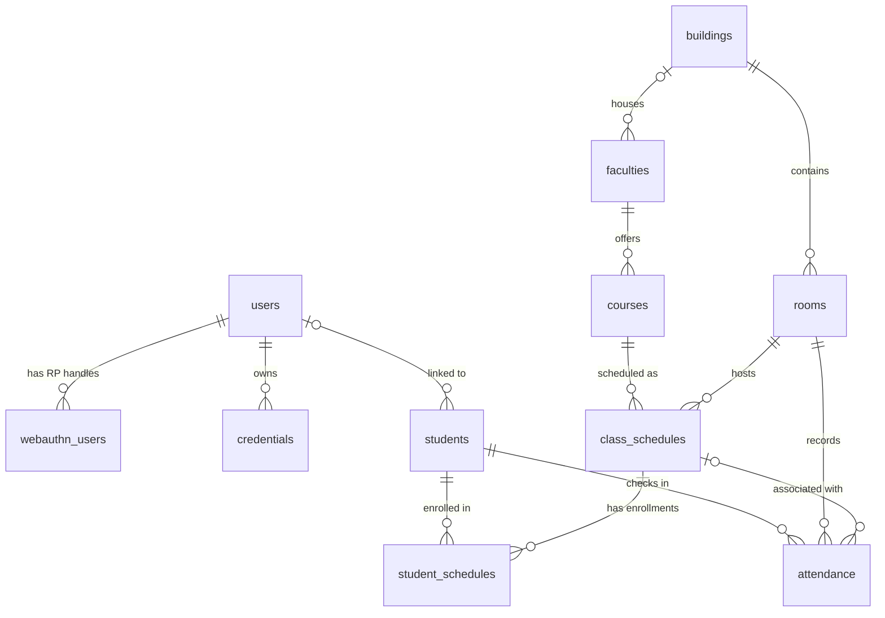

# Appsensi Server

**English** | [Bahasa Indonesia](README.id.md)

[](go.mod)
[](https://github.com/gin-gonic/gin)
[](https://gorm.io/)
[](https://github.com/go-webauthn/webauthn)
[](LICENSE)

Backend REST API server for **Appsensi**, a campus academic attendance platform built with Go, Gin, PostgreSQL (GORM), and passwordless **WebAuthn / Passkey** authentication.

---

## Features

- **Passwordless Passkey Authentication**: Full WebAuthn registration and assertion ceremonies powered by `go-webauthn`, configured with resident keys, cross-platform/hybrid authenticator hints, duplicate-credential exclusion, sign-count tracking, and credential clone detection.
- **Student-Linked Onboarding**: Automatically provisions user accounts from verified student records (`students.student_id`) during initial passkey registration.
- **Origin-Aware CORS & RP Validation**: Unified `ALLOWED_ORIGINS` configuration shared between Gin's CORS middleware (with credentials & preflight support) and WebAuthn Relying Party origin verification.
- **Academic & Attendance Data Model**: Strongly typed PostgreSQL GORM models covering campus buildings, rooms, faculties, courses, class schedules, student enrollments, and room/session attendance records.

## Tech Stack

| Layer | Technology | Version |
| :--- | :--- | :--- |
| Language | [Go](https://go.dev/) | `1.27.0` |
| HTTP Framework | [Gin](https://github.com/gin-gonic/gin) | `v1.12.0` |
| Authentication | [go-webauthn/webauthn](https://github.com/go-webauthn/webauthn) | `v0.18.2` |
| ORM & Database Driver | [GORM](https://gorm.io/) + `gorm.io/driver/postgres` | `v1.31.2` / `v1.6.3` |
| Identifiers | [google/uuid](https://github.com/google/uuid) | `v1.6.0` |

## Project Structure

```text
appsensi-server/
├── config/
│   ├── cors.go          # ALLOWED_ORIGINS parser & Gin CORS middleware
│   ├── cors_test.go     # Unit tests for CORS preflight & origin parsing
│   └── webauthn.go      # go-webauthn Relying Party initialization
├── controllers/
│   └── auth.go          # WebAuthn registration/login handlers & in-memory session store
├── database/
│   └── db.go            # PostgreSQL GORM connection setup
├── models/
│   ├── academic.go      # Building, Room, Faculty, Course, ClassSchedule models
│   ├── schema_test.go   # Unit tests verifying GORM column-to-JSON tag alignment
│   ├── student.go       # Student, StudentSchedule, Attendance models
│   └── user.go          # User, WebAuthnUser, Credential models (implements webauthn.User)
├── LICENSE              # MIT License
├── README.id.md         # Bahasa Indonesia documentation
├── README.md            # English documentation (default)
├── go.mod
├── go.sum
└── main.go              # Application entry point & HTTP route definitions
```

---

## Getting Started

### Prerequisites

- **Go** `1.27` or newer
- **PostgreSQL** `13` or newer (uses built-in `gen_random_uuid()` for UUID primary keys)
- A WebAuthn-capable browser accessed over `http://localhost` (or HTTPS in production)

### Environment Variables

| Variable | Default | Description |
| :--- | :--- | :--- |
| `PORT` | `8080` | Port the HTTP server listens on. |
| `DATABASE_URL` | *(local dev fallback in `database/db.go`)* | PostgreSQL connection string / DSN (e.g., `host=localhost user=postgres password=<password> dbname=appsensi port=5432 sslmode=disable TimeZone=Asia/Jakarta` or `postgres://...`). |
| `ALLOWED_ORIGINS` | `http://localhost:3000` | Comma-separated list of frontend origins permitted by both CORS and WebAuthn `RPOrigins` (trailing slashes and whitespace are trimmed automatically). |

> [!IMPORTANT]
> **Local Development Notes**
> 1. **Database Migrations**: `db.AutoMigrate(...)` in `database/db.go` is commented out by default, assuming the PostgreSQL schema is already provisioned. For a fresh local database, apply your SQL schema first or uncomment the `AutoMigrate` block in `database/db.go`.
> 2. **Student Record Prerequisite**: When registering a username for the first time, `POST /register/begin` queries the `students` table for `student_id = username` to create the `users` row and populate `display_name` from `students.name`. Seed a matching `students` record before registering a new user.
> 3. **WebAuthn `RPID` & Challenge Sessions**: `RPID` is currently set to `"localhost"` in `config/webauthn.go`. Open your frontend client via `http://localhost:<port>` (not `127.0.0.1`) so browser WebAuthn validation succeeds. Active registration/login challenges are kept in an in-memory map in `controllers/auth.go`.

### Installation & Running

1. **Clone the repository and install dependencies**:
   ```bash
   git clone https://github.com/hapnan/appsensi-server.git
   cd appsensi-server
   go mod download
   ```

2. **Configure environment variables and start the server**:

   **PowerShell (Windows)**
   ```powershell
   $env:PORT = "8080"
   $env:DATABASE_URL = "host=localhost user=postgres password=<password> dbname=appsensi port=5432 sslmode=disable TimeZone=Asia/Jakarta"
   $env:ALLOWED_ORIGINS = "http://localhost:3000"
   go run main.go
   ```

   **Bash (Linux / macOS)**
   ```bash
   export PORT="8080"
   export DATABASE_URL="host=localhost user=postgres password=<password> dbname=appsensi port=5432 sslmode=disable TimeZone=Asia/Jakarta"
   export ALLOWED_ORIGINS="http://localhost:3000"
   go run main.go
   ```

3. **Verify the server is running**:
   ```bash
   curl http://localhost:8080/ping
   # {"message":"pong"}
   ```

---

## Authentication Flow & API Reference

### Passkey Registration & Login Sequence



### Endpoints Summary

| Method | Path | Description |
| :--- | :--- | :--- |
| `GET` | `/ping` | Health check endpoint returning `{"message": "pong"}`. |
| `POST` | `/register/begin` | Generates WebAuthn credential creation options for a student. |
| `POST` | `/register/finish` | Verifies attestation response and stores the passkey credential. |
| `POST` | `/login/begin` | Generates WebAuthn assertion options for an existing registered user. |
| `POST` | `/login/finish` | Verifies signed assertion and updates credential usage metadata. |

### Endpoint Details

#### `GET /ping`
Returns server liveness status.
- **Response (`200 OK`)**:
  ```json
  {
    "message": "pong"
  }
  ```

#### `POST /register/begin`
Starts a WebAuthn registration session. Creates a `users` record (linked by `username` to `students.student_id`) and a `webauthn_users` handle if not already present, excluding any credentials already registered to the user.
- **Request Body**:
  ```json
  {
    "username": "20260001",
    "email": "student@example.edu"
  }
  ```
- **Response (`200 OK`)**: Standard WebAuthn `CredentialCreation` JSON (`{ "publicKey": { ... } }`).

#### `POST /register/finish`
Completes passkey registration. Expects a single JSON object containing **`username` and `email` at the top level** merged with the browser's WebAuthn `PublicKeyCredential` attestation response.
- **Request Body**:
  ```json
  {
    "username": "20260001",
    "email": "student@example.edu",
    "id": "<base64url-credential-id>",
    "rawId": "<base64url-credential-id>",
    "type": "public-key",
    "response": {
      "attestationObject": "<base64url>",
      "clientDataJSON": "<base64url>"
    }
  }
  ```
- **Response (`200 OK`)**:
  ```json
  {
    "status": "registration success"
  }
  ```

#### `POST /login/begin`
Starts a WebAuthn login ceremony for an already-registered user without creating new database rows.
- **Request Body**:
  ```json
  {
    "username": "20260001"
  }
  ```
- **Response (`200 OK`)**: Standard WebAuthn `CredentialAssertion` JSON (`{ "publicKey": { ... } }`).
- **Error (`404 Not Found`)**: Returned if the user does not exist or has no WebAuthn handle for the current `RPID`.

#### `POST /login/finish`
Completes passkey authentication. Expects **`username` at the top level** merged with the browser's WebAuthn `PublicKeyCredential` assertion response. Updates `sign_count`, `clone_warning`, and `last_used_at` on the matched credential.
- **Request Body**:
  ```json
  {
    "username": "20260001",
    "id": "<base64url-credential-id>",
    "rawId": "<base64url-credential-id>",
    "type": "public-key",
    "response": {
      "authenticatorData": "<base64url>",
      "clientDataJSON": "<base64url>",
      "signature": "<base64url>",
      "userHandle": "<base64url>"
    }
  }
  ```
- **Response (`200 OK`)**:
  ```json
  {
    "status": "login success",
    "message": "User authenticated successfully"
  }
  ```

### CORS Behavior

- Configured origins in `ALLOWED_ORIGINS` receive `Access-Control-Allow-Origin: <origin>` and `Access-Control-Allow-Credentials: true`.
- `OPTIONS` preflight requests from allowed origins (or requests without an `Origin` header) respond with `204 No Content`.
- `OPTIONS` preflight requests from unlisted origins are rejected with `403 Forbidden`.

---

## Database Schema

### Entity-Relationship Diagram



### Tables Overview

#### Authentication & Passkeys (`models/user.go`)

| Table | Model | Purpose |
| :--- | :--- | :--- |
| `users` | `User` | Core account table (`id`, `email`, `username`, `display_name`), implementing `webauthn.User`. |
| `webauthn_users` | `WebAuthnUser` | Stores the opaque 32-byte WebAuthn user `handle` scoped per `(rp_id, user_id)`. |
| `credentials` | `Credential` | Stores registered passkey public keys, `aaguid`, attestation metadata, transports, flags, `sign_count`, `clone_warning`, and `last_used_at`. |

#### Academic & Attendance (`models/academic.go`, `models/student.go`)

| Table | Model | Purpose |
| :--- | :--- | :--- |
| `buildings` | `Building` | Campus building metadata (`code`, `name`, `purpose`, `has_classes`, `total_floors`). |
| `rooms` | `Room` | Classrooms and facilities tied to a `building_id` (`code`, `floor`, `room_number`, `capacity`). |
| `faculties` | `Faculty` | Academic faculties (`code`, `name`), optionally associated with a home `building_id`. |
| `courses` | `Course` | Courses offered by a faculty (`code`, `name`, `credits`, `description`, `faculty_id`). |
| `class_schedules` | `ClassSchedule` | Scheduled course sections (`course_id`, `room_id`, `section`, `instructor`, `day_of_week`, `start_time`, `end_time`, `academic_term`). |
| `students` | `Student` | Student directory (`student_id`, `name`, `department`, `photo_url`, optional `user_id`). |
| `student_schedules` | `StudentSchedule` | Join table tracking student enrollments in `class_schedules` (`status`, `enrolled_at`). |
| `attendance` | `Attendance` | Daily student room/session check-in logs (`student_id`, `room_id`, optional `class_schedule_id`, `session_date`, `checked_in_at`). |

---

## Testing

Run the full unit test suite without requiring a live PostgreSQL instance:

```bash
go test -v ./...
```

Current test suites cover:
- **`config/cors_test.go`**: `ALLOWED_ORIGINS` parsing (whitespace/trailing-slash normalization) and CORS middleware responses for allowed origins, credential headers, and disallowed preflight requests.
- **`models/schema_test.go`**: Verifies that every GORM model column name matches its `json` struct tag (including explicit column overrides such as `Credential.AAGUID` -> `aaguid` and `WebAuthnUser.RpID` -> `rp_id`).

---

## License

Distributed under the [MIT License](LICENSE).
